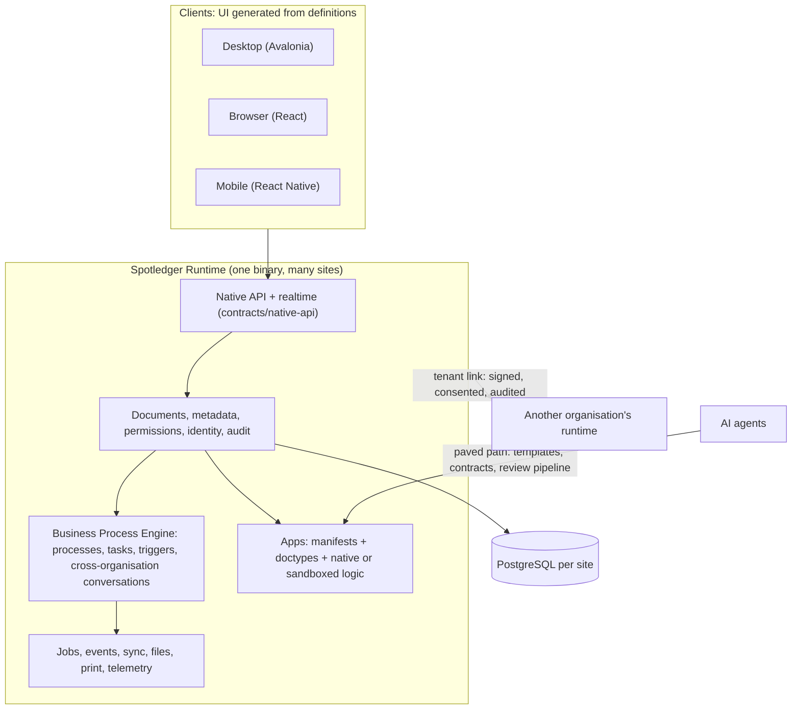

# Spotledger Runtime

**An open-source platform for the digital services a government runs, without the cost and lock-in of proprietary systems.**

Councils, agencies and public bodies spend heavily on software that ties them to one vendor, cannot talk to the systems next door and is slow and expensive to change. Spotledger Runtime is a different starting point: one open, shared platform that every service is built on, so permits, licences, payments, case handling, records and the other services a public body provides all work the same way.

### From the law to the working process, and test it before anyone depends on it

A service starts as a rule: a law, a regulation or a policy. On this platform that rule becomes an explicit, versioned process: who does what, in which order, under which conditions, with what deadlines. Because the process is data rather than hidden in custom code, it can be **simulated end to end before it is used**: run the whole service with test applicants, partner organisations and heavy load, and see where it stalls, where it breaks the rule or where it would not cope, before a single real person is affected. When the law changes, the process changes with it, and every earlier version stays on record.

### What this gives a public body

- **No licence fees and no lock-in.** Apache-2.0: free to use, inspect, run and change. The code is public, so you can audit it, and you never depend on a single supplier.
- **Services that work together.** Every application shares the same foundations: who a person is, what they are allowed to do, a permanent record of every action and one way to exchange information. Departments, neighbouring councils and vendors connect without a custom integration project.
- **Built to serve at scale.** Designed for the users and records of a whole city or country.
- **Your choice of database.** Storage sits behind an open, published contract, so it is not tied to one product. PostgreSQL, which governments already trust and run, is the default and the recommended choice.
- **Accountable by design.** Permissions, an audit trail and the separation between organisations are part of the platform, not add-ons.
- **AI as part of the platform.** AI agents help build, extend and operate services on the same foundations, under the same permissions and the same audit trail as people. The AI works inside the rules the platform enforces.

### Operations a public body can run on it

Each of these is a complete service, from the first application to the final record, built as an explicit process that can be simulated before use. They are examples of what the platform is designed for. None ships as a finished product yet, and each one is built as an application on the platform.

- **Run the entire tax and fee collection operation.** Register taxpayers and properties, issue assessments and bills when the law says they fall due, take payments through connected payment providers, send reminders, apply penalties and payment plans on the dates the law sets, handle objections and appeals, and keep a permanent record of every step for audit.
- **Run permits and licences from application to inspection.** An applicant submits a request for a building, trading or event permit. The process checks it against the rules, routes it to every department that must approve, schedules the inspection, issues the permit and tracks renewal and expiry, with each deadline enforced and each decision on record.
- **Run social benefits and assistance, including appeals.** Take the application, check eligibility against the legal criteria, request documents from the applicant, pay the benefit on schedule, reassess when circumstances change, and give a clear route to appeal, with each decision explained and recorded.
- **Run procurement and tenders end to end.** Publish a tender, receive and seal bids, evaluate them against the published criteria, record approvals and any challenge, award the contract and follow delivery and payment, so that the whole trail can be audited.
- **Run citizen requests and complaints to closure.** Receive a report (a broken streetlight, a missed collection, a complaint), route it to the responsible team, dispatch field staff on mobile, update the citizen, and close it only when the work is confirmed, with response times measured against the targets.
- **Run land, property and civil records.** Register and transfer ownership, record births, marriages and deaths, issue certified extracts, and keep every amendment and who authorised it, never overwriting what was recorded before.
- **Run services shared between agencies or councils.** A resident moves from one council to another, or a case needs three agencies. Each organisation keeps control of its own data, and the process hands the case across and keeps one continuous record.

**Who it is for:** city councils, government agencies, and enterprises that must serve large numbers of people reliably. For technical readers: a Rust application platform with a pluggable storage contract, PostgreSQL by default. The documentation starts below.

It is the base of the Spotledger ERP, and it is built to carry other applications as well. The ERP is not in this repository.

> **Status: pre-release, in active development (version 0.x).** The foundations are in place and under active development. It is not yet ready to run a live public service, and there are no certifications, reference deployments or benchmark results yet. The runtime, the contracts and the Avalonia desktop client exist and are tested; web and mobile clients, the AI layer and the scale claims are still being built or proven. See [Status](#status) for the honest picture, the [roadmap](ROADMAP.md) for what exists and what is next, and [SECURITY.md](SECURITY.md) before you run it anywhere that matters.

## The two problems

### 1. Systems with no shared agreement

A government, or a large enterprise, runs dozens of services. Some are built in-house, some by outside vendors, each on its own stack: its own storage design, its own identity, its own audit trail, its own way of exchanging data. The result is systems with many moving parts and no fundamental agreement between them. Every integration is a custom project; every new service repeats decisions already made elsewhere; responsibilities for security, data residency and audit are scattered across codebases that cannot be reviewed together.

### 2. Building with AI means rebuilding the foundations every time

AI coding agents are fast, but each new project starts from a blank page. The agent writes its own boilerplate, its own infrastructure, its own idea of scalability, its own storage layer and its own security model. Every one of those choices must then be reviewed and reconciled by people, and the storage contracts and security model are the hardest to reconcile after the fact. Speed gained at the keyboard is lost in review, and the results still do not fit together.

## The approach

Fix the foundations once, in a runtime, and make them the only path:

- **Shared contracts.** Storage, events, the native API, the app API and UI extension points are versioned interfaces in [`contracts/`](contracts/). An application does not invent its own; it uses these.
- **The runtime owns the hard parts.** Tenancy and data residency, identity and access, permissions, audit, jobs, sync between sites, files, printing, observability and the sandbox for extensions are runtime services, not per-application work.
- **Everything is a process.** Work is modelled as processes (who acts, in what order, what waits for what, what happens on timeout) on one durable engine, so rules, approvals, audit and cross-organisation exchange are the same mechanism in every application. See [the Business Process Engine](#everything-is-a-process-the-business-process-engine).
- **Applications are data plus small amounts of code.** An application is a manifest, document type definitions and permissions, plus optional native or sandboxed logic. What is declarative can be generated, reviewed and checked by tools.
- **Paved paths for AI agents.** An agent building on the runtime is not asked to make infrastructure decisions. It works inside a path where storage, security, scaling and integration are already decided, and where a review pipeline checks the result against the same contracts a human would.
- **Organisations connect through the runtime, not around it.** Two organisations (or two government bodies) on the runtime exchange data over an explicit, consented, auditable link, with residency rules and versioned topics, not through a custom integration.

## Everything is a process: the Business Process Engine

In the runtime, every piece of work is a process: adding an employee, issuing a licence, filing a return, transferring a vehicle. A process says who acts next, what waits for what, what happens on a timeout, and which records are created along the way. Records still own their own rules and lifecycle (validation, states, permissions); processes own the who, when and order, and a process step changes a record only through the record's own lifecycle, so every rule runs exactly as it would on a user's click ([ADR-080](docs/adr/ADR-080-process-first-operation-names-and-processes-across-organisations.md)).

### What the engine provides

| Capability | Where |
| --- | --- |
| **Process model**: processes, versions, typed steps and edges, a reviewable text form, validation that reports every problem at once, compiled onto a durable graph runtime | `spot-bpm-model`, `spot-dag` |
| **Durable execution**: state saved per step, resume after a crash, idempotent steps, retries and error branches, parallel paths and joins, sub-processes, timers | `spot-bpm-engine`, `spot-dag-exec` |
| **Human work**: task inbox, claim, delegate, reassign, SLAs, reminders, escalation, segregation-of-duties checks | `spot-bpm-tasks` |
| **Triggers**: committed events, schedules, signed webhooks, manual start, API; exactly one run per source event | `spot-bpm-triggers` |
| **Process-first entry**: "Start" replaces "New". In `process_only` scopes no record can be created outside a process, in any channel | `spot-bpm-entry`, `spot-bpm-governance` |
| **Processes across organisations**: a signed process contract states the participants, the messages and the fields that may cross, the order and the timeouts; incoming and outgoing messages are checked against it | `spot-bpm-contract`, `spot-bpm-conversations`, `spot-link-exchange` |
| **Undo and compensation**: every request keeps its receipts; rewind or undo reverses effects in dependency order and stops with blockers when a reversal is refused; held effects are released at commit points | `spot-bpm-effects`, `spot-bpm-commit`, `spot-bpm-effect-checks` |
| **Change without breakage**: running requests stay on the version they started with; optional migration with dry-run; a declared compensation step when an upstream record is cancelled | `spot-bpm-versioning` |
| **Process insight**: cycle time per step, waiting versus work time, bottlenecks, stuck-request queue | `spot-bpm-insight` |
| **Integration steps**: HTTP, e-mail, webhooks, sandboxed connectors, data mapping, credentials from a vault and never in logs | `spot-bpm-integration` |

People see the word **"Request"** by default, never the internal term; an organisation can rename it to "Application", "Claim", "File" or "Admission".

### Model it, simulate it, then see how it behaves

A process fully specifies its steps, its forms, its participants and its timing. That is what lets the runtime show how a design will behave before any custom system exists:

- **Run it without the real world.** The engine includes a deterministic simulation harness. The designer is meant to offer test runs with sample data and a partner simulator, so an analyst can test a flow between two organisations with no partner connected.
- **See the screens.** Forms, task inboxes and status views follow from the process and the document types, so the same definition shows what a citizen, a clerk and a supervisor would see on desktop, mobile and browser.
- **See the load.** Because the shape of the work is explicit (how many requests start, how many steps wait for people, where timers fire), the runtime and its insight reports can show waiting points and bottlenecks under a simulated load.

The simulation harness exists in the engine. The visual designer, the partner simulator and the load profiles are in development; see [Status](#status).

### Where it fits

These are the kinds of systems the engine is designed for. They share one shape: long-lived, multi-party, rule-heavy work with strict audit. The pain points are the typical ones in such systems; we will document each domain in depth separately.

| Domain | The process | Typical pain points |
| --- | --- | --- |
| **National identity and civil registration** | Enrolment, verification, issue, renewal, replacement, birth/marriage/death records | Duplicate or conflicting identities; the same data re-keyed across agencies; slow manual verification; backlogs; lost or forged paper; citizens sent from office to office |
| **Taxation and revenue** | Registration, returns, assessment, refunds, audit, objection and appeal | Data from employers, banks and customs that does not reconcile; filing-deadline peaks; yearly rule changes while old cases are still open; long dispute cycles |
| **Healthcare** | Admission, referral, prescription, claims, discharge, consent | Records scattered across providers; unclear consent; claim rejection loops; waiting lists with no visibility; no single audit trail across organisations |
| **Vehicle registration and number plates** | Registration, ownership transfer, fitness, fines, plate issue and replacement | Transfers needing buyer, seller, bank, insurer and police to agree; liens and stolen-vehicle flags in other systems; cloned or fake plates; plate production batching; fines not linked to the owner |
| **Land and property registry** | Title search, transfer, mortgage, inheritance, mutation | Multi-party transfers and fraud; paper records; disputes over order of events; slow certified copies |
| **Customs and trade** | Declaration, assessment, inspection, clearance, release | Many agencies each with its own clearance; duplicate documents; unpredictable waiting; hard to trace a shipment's state |
| **Business licensing and permits** | Application, inspections, approvals, renewal, revocation | Each department asks for the same documents; no one sees the whole file; unclear status; inconsistent rules by officer |
| **Social benefits and pensions** | Eligibility, payment, review, suspension, appeal | Eligibility data held by other agencies; fraud and error; payment runs that must be exact; appeals that restart the file |
| **Courts and case management** | Filing, scheduling, hearings, orders, enforcement | Long-lived cases with legal deadlines; many parties and documents; adjournments; enforcement handled outside the system |
| **Procurement and tenders** | Planning, tender, evaluation, award, contract, payment | Segregation-of-duties and conflict-of-interest controls; audit demands; amendments mid-process; slow approvals |
| **Passports, visas and immigration** | Application, background checks, interview, issue, renewal | Checks across several agencies and countries; appointment backlogs; status invisible to the applicant |
| **Municipal services and utilities** | Connection, billing, complaints, field work orders | Field staff offline; requests lost between departments; no SLA tracking |

## How the pieces fit



The client boxes are the target. The desktop client exists today; the browser and mobile clients are in development (see [Status](#status)).

## What makes the agreement concrete

Each item is a crate, contract or decision record you can read. Maturity varies; the [status table](#status) says where.

| Shared agreement | Where it lives |
| --- | --- |
| **Storage contract**: how documents and queries reach the database, with a fake and a PostgreSQL implementation held to the same parity tests | [`contracts/storage`](contracts/storage), `spot-storage-fake`, `spot-storage-parity`, [storage semantics](docs/storage-semantics.md) |
| **Events and the outbox**: one event and outbox schema, recoverable journal | [`contracts/events`](contracts/events), [ADR-056](docs/adr/ADR-056-event-and-outbox-schema-v0.1.md), [ADR-061](docs/adr/ADR-061-event-journal-recoverable-record.md) |
| **One native API** over HTTP, with realtime and health endpoints | [`contracts/native-api`](contracts/native-api) (OpenAPI, version 0.11.1) |
| **Tenancy and residency**: one tenant per site and database, regional placement | [ADR-058](docs/adr/ADR-058-tenancy-residency-and-tenant-link.md) |
| **Links between organisations**: pairwise, signed handshake with both sides' consent, grants per topic, expiry, residency requirement, immediate revocation, audit on both sides | `spot-tenant-link`, `spot-link-exchange`, [ADR-058](docs/adr/ADR-058-tenancy-residency-and-tenant-link.md), [ADR-080](docs/adr/ADR-080-process-first-operation-names-and-processes-across-organisations.md) |
| **Sync between hubs and edges**: ownership per record, at-least-once delivery with idempotent apply, dependency closure, catch-up after offline periods, self-healing | [ADR-062 to ADR-067](docs/adr/ADR-062-sync-charter-and-architecture.md), `spot-edge-sync` |
| **Identity**: staff and partners separate from public consumers, scaling design for millions of consumer identities | [ADR-070](docs/adr/ADR-070-identity-user-management-and-access-administration.md), ADR-083 |
| **Integration**: connectors in a sandbox, EDI adapters | `spot-connectors`, `spot-edi` |

## The paved path for AI agents

What an agent no longer has to invent:

| The agent does not write | Because the runtime provides |
| --- | --- |
| A storage layer, migrations, queries | The storage contract and metadata-driven schema |
| Authentication, roles, field-level access | Identity and permission services; permission files in the app |
| Audit trails and change history | Built-in audit chain and event journal |
| Multi-tenant isolation and residency | Tenancy model and tenant link |
| Background jobs, scheduling, retries | Job and scheduler services; resilience kit (retry, deadline, breaker, bulkhead) |
| Realtime, files, print, metrics | Runtime services behind the native API |
| Workflow, approvals, deadlines, escalation | The Business Process Engine; the agent describes the process and the runtime executes it durably |
| Cross-system integration | Tenant links, process contracts and versioned topics; connector sandbox |

What the agent gets:

- **A small, declarative target.** An app is a manifest, document types and permissions. See [`apps/sample`](apps/sample), a Projects-and-Tasks app that exercises the platform.
- **Types from the metadata.** Definitions are generated from document types, so editors and agents check against the real fields.
- **Templates** for connectors and apps in Rust, C#, Go, JavaScript and Python under [`sdk/`](sdk/).
- **A sandbox for extension code.** Sandboxed WASM components with fuel, memory and egress limits (`spot-connectors`, `spot-app-compose`).
- **A review pipeline.** `spot-app-review` runs static checks, a security scan, a bounded resource profile and contract probes, and produces one report a human reads.
- **Workload isolation for AI.** `spot-ai-isolation` gives AI traffic its own role, quotas and circuit breakers, so parallel agents cannot degrade interactive users.
- **Developer tooling.** `spot-devtools` provides tracing and debugging across layers.

Two building blocks for agents exist as crates: an MCP server core (`spot-mcp`, tools generated from the effective metadata, every call run as the calling user) and a system self-model (`spot-self-model`, a graph of document types, apps, permissions and runtime health that can answer "why did this change?"). The design is in [ADR-26 of the blueprint](docs/blueprint/platform.md); see the Status table for what is and is not finished.

## UI generated for desktop, mobile and browser

The user interface is not hand-built per application and per device. An application declares its screens as definitions against a fixed catalogue of controls, with composition and navigation rules set by the platform ([ADR-068](docs/adr/ADR-068-field-model-formats-lookups-and-controls.md), [ADR-069](docs/adr/ADR-069-ui-composition-navigation-and-compiled-ui-bundle.md)). AI agents generate those definitions, and the clients render them:

- **Desktop:** Avalonia client ([`clients/avalonia`](clients/avalonia)). Exists.
- **Browser:** React ([ADR-091](docs/adr/ADR-091-web-and-mobile-client-stack-react-and-react-native.md)). In development.
- **Mobile:** React Native, same ADR. In development.
- **One core under all three:** a shared Rust client core handles data, caching and sync so the clients behave the same way (ADR-088).
- **Custom views:** server-hosted UI components computed in a signed sandbox and rendered by the host (ADR-084, proposed).

Because the AI produces declarations and not free-form front-end code, its output stays inside the permission model and the control catalogue, and it can be checked.

## Who it is for

- **Government bodies and system integrators** who need services from different teams and vendors to share storage, identity, audit and exchange rules instead of each carrying its own.
- **Enterprises and groups** running many applications, entities and regions, including offline branches that must catch up reliably.
- **Teams building with AI agents** who want the agents' output to land on foundations that are already decided and reviewable.

## What is in this repository

| Area | Where |
| --- | --- |
| About 240 framework crates (storage access, metadata, documents, permissions, identity, jobs, events, sync, workflow models, HTTP and realtime, files, printing, security tooling) | [`crates/framework/`](crates/framework/) |
| Business Process Engine crates (`spot-bpm-*`, `spot-dag*`) | [`crates/framework/`](crates/framework/) |
| PostgreSQL implementations of the framework's store interfaces | [`crates/backends/`](crates/backends/) |
| Versioned contracts | [`contracts/`](contracts/) |
| The `spot` binary: `new-site`, `serve`, `check`, `reload` | [`crates/framework/spot-cli`](crates/framework/spot-cli) |
| Platform app and sample app | [`apps/`](apps/) |
| Desktop client | [`clients/avalonia`](clients/avalonia) |
| SDK templates | [`sdk/`](sdk/) |
| Test harnesses | [`harness/`](harness/) |
| Architecture decisions and the platform blueprint | [`docs/adr/`](docs/adr/), [`docs/blueprint/platform.md`](docs/blueprint/platform.md) |

This repository is the **Platform layer**: it knows documents, tenants, apps, events, jobs, users and permissions, and nothing about money, accounts, products or stock. The Foundation and ERP layers sit on it and are separate products.

## Building and running

You need Rust (pinned in [`rust-toolchain.toml`](rust-toolchain.toml)) and PostgreSQL 18 for anything that touches the database. For a reproducible environment see [`dev-environment/`](dev-environment/).

```sh
cargo build -p spot-cli --locked   # builds the `spot` binary (about 3 minutes on a recent Linux workstation, from a cold cache)
cargo test -p spot-dag --locked    # example of a per-crate test run; no database needed
```

The `spot` binary then answers `spot --help` with its commands (`new-site`, `serve`, `install-app`, `list-apps`, `migrate`, `add-user`, `set-password`, `reset-admin`, `reload`, `check`). The build and the example test run above were checked on Linux (Fedora) on 2026-11-09. Tests that need PostgreSQL are run per crate against a PostgreSQL 18 instance (see [`dev-environment/`](dev-environment/)); a full `cargo test --workspace` is not part of this quick start. Windows is not yet part of the checked quick start.

Then follow [docs/running-spot.md](docs/running-spot.md): create a site, serve it, check health at `/api/health/ready`. The Avalonia client has its own [README](clients/avalonia/README.md).

## Design rules the build enforces

These are workspace lint settings the build enforces, with local exceptions that are visible in the code:

- `unsafe` code is forbidden by default (`unsafe_code = "forbid"`). Two crates that talk to the operating system opt out and say why in their `Cargo.toml`: `spot-pg-supervisor`, and `spot-agent-windows`, where only one Windows-specific module (`src/real.rs`) allows it.
- `unwrap()` is denied by default (`clippy::unwrap_used`). About 140 files opt out locally, mostly test code and PostgreSQL backend code.
- Floating-point arithmetic is denied by default (`clippy::float_arithmetic`), because money and quantities must not use binary floats. The few local exceptions are in vector search and embeddings (`spot-retrieval`, `spot-agent-memory`) and in telemetry export (`spot-telemetry`), none of which handles money.
- Dependency licences and sources are checked by `cargo deny` ([`deny.toml`](deny.toml)).
- Layer rules (Platform depends on nothing above it) are checked by a lint in CI.

## Status

| Area | State |
| --- | --- |
| Runtime server (`spot serve`), sites, native API, health and metrics | In the repository and documented; pre-release |
| Storage, events, native API, app API contracts | Versioned (native API 0.11.1); will change before 1.0 |
| Business Process Engine: model, durable execution, tasks, triggers, cross-organisation conversations, undo, versioning, insight | Crates exist; each has between 17 and 80 unit and integration tests (about 800 across the BPM crates, `spot-dag` and `spot-dag-exec`); not yet proven under load |
| Visual process designer, partner simulator, load profiles | In development |
| Tenancy, tenant link, link exchange, sync | Designed in accepted or proposed ADRs; implemented as crates; maturity varies |
| Sandbox, connectors, app review pipeline | Crates exist |
| Desktop client (Avalonia) | Exists |
| Browser (React) and mobile (React Native) clients | Decided ([ADR-091](docs/adr/ADR-091-web-and-mobile-client-stack-react-and-react-native.md)); in development |
| AI layer: MCP server core (`spot-mcp`), system self-model (`spot-self-model`), AI workload isolation (`spot-ai-isolation`) | Crates exist with tests |
| AI layer: support and operations agents, end-to-end worked example of an agent building an application | Designed (blueprint WS13); delivered in stages after the platform is stable |
| Foundation and ERP | Separate products, not in this repository |

Test counts are the number of `#[test]` and `#[tokio::test]` functions in each crate's source and tests directories, counted on 2026-11-09; they say tests exist, not that every behaviour is covered.

### What is not proven yet

- **Scale.** The blueprint defines size tiers and non-functional targets (ADR-41) and the tests are built around them. We have not published benchmark results at those sizes.
- **Operation in government or regulated settings.** The design aims at tenant isolation, audit and residency. There are no certifications and no public reference deployments.
- **Security.** No independent audit yet. Known weaknesses are tracked while the code is pre-release.
- **Replay protection and idempotency across restarts.** Durable PostgreSQL stores exist for replay protection (single sign-on assertions, signed commands, agent commands) and for HTTP idempotency keys, but the server and agent hosts do not use them everywhere yet. Where a host still uses the in-memory store, what it remembers is lost when the process restarts, so do not rely on these protections across restarts or across several nodes until the roadmap item below is done.
- **Stability.** Storage formats and APIs can change between pre-release versions.
- **AI-built applications.** The paved path is the design and the tooling is in progress. We have not yet published a worked example of an agent building a complete application end to end.

## Project model

- **Licence:** [Apache-2.0](LICENSE). The name and logo are not licensed; see [TRADEMARKS.md](TRADEMARKS.md).
- **Maintainer:** Spotledger (SMC-PRIVATE) Limited.
- **Development:** in a private repository; this repository is a periodically synchronised public copy, so history here is summarised.
- **Contributions:** not accepted; pull requests are restricted. Security reports are welcome: [SECURITY.md](SECURITY.md).
- **Support:** none promised.

## Documents

[ROADMAP.md](ROADMAP.md) · [docs/running-spot.md](docs/running-spot.md) · [docs/blueprint/platform.md](docs/blueprint/platform.md) · [docs/adr/](docs/adr/) · [contracts/](contracts/) · [SECURITY.md](SECURITY.md) · [NOTICE](NOTICE) · [THIRD_PARTY_LICENSES](THIRD_PARTY_LICENSES)
