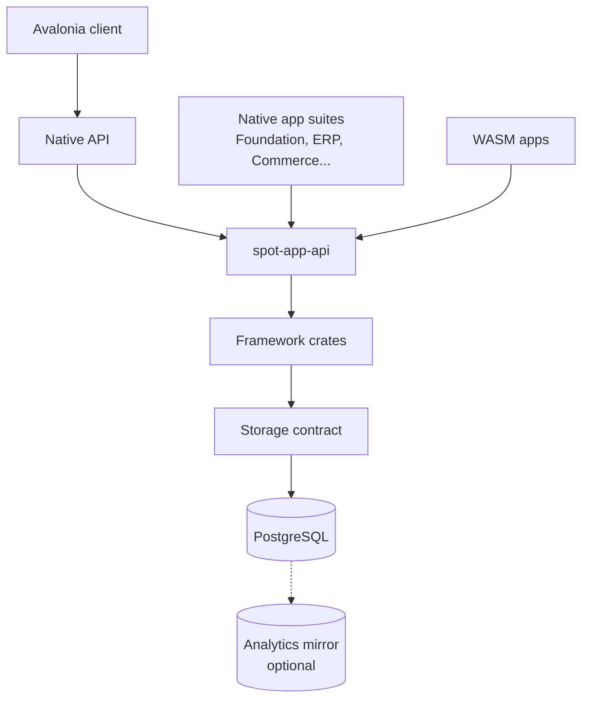
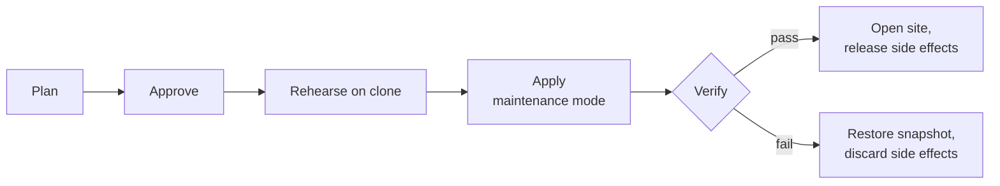

# Spotledger Platform blueprint

Layer: **Platform** (see the blueprint index for the layer rules). The platform is a Rust app platform inspired by Frappe's metadata model. It has no business concepts: everything about money, parties, products, stock and tax lives in `foundation.md` and `erp.md`.

## 1. Architecture decisions

| ID | Decision | Consequence for agents |
| --- | --- | --- |
| ADR-01 | One executable, modular crates; subsystems split by role config, not by process | No crate may assume it runs in the same process as another; talk through interfaces/events |
| ADR-02 | PostgreSQL is the single system of record on every tier (desktop, server, cloud, edge site); scale-out through Citus schema-based sharding; graph through an extension behind the traversal API. SurrealDB is dropped for now (lab and research evidence: planner gaps, slow aggregate reports, recent upstream silent-wrong-result bugs) and may return later only as a projection | No backend-specific query in app code; everything goes through the storage contract |
| ADR-05 | Metadata stays runtime data; documents are dynamic, with generated typed views | Nothing a user changes in the UI may need a rebuild or restart |
| ADR-06 | Core suites (the ERP among them) are apps linked natively; they depend only on `spot-app-api` | CI rejects any ERP crate depending on framework internals |
| ADR-07 | Third-party extensions are WASM components (WIT contract, Wasmtime host) | Same app API as native apps; capability manifest required |
| ADR-08 | Extensibility via lifecycle pipelines and named service seams, never monkey patching | Every overridable behaviour must be a registered step or seam |
| ADR-09 | No Frappe Desk. Avalonia is the only client and is built from M1 alongside the framework | Every framework milestone is validated through Avalonia screens and the native API |
| ADR-10 | UI business logic lives server-side (metadata + form-event endpoint) or in pure calculation crates | No business rule is implemented in JS or C#. Data-dependent calculations run in three stages: the server resolves a versioned context (rates, categories, thresholds, cumulative figures); pure crates compute anywhere for instant preview; the server re-resolves and finalizes on save, and only that result counts |
| ADR-11 | Transactional outbox for events; no dual writes | Every business event is written in the same transaction as its document |
| ADR-12 | Money and quantities are decimal types; rounding rules are data, declared by the app that needs them | No floating-point arithmetic in business logic |
| ADR-13 | Graph use split three ways: DAG definitions in memory, DAG state transactional, business graph via traversal API | DAG/BPM work is scheduled after the core API is stable |
| ADR-14 | Multi-site deployments use single-writer ownership per partition | No design may require merging concurrent writes to the same entity |
| ADR-15 | Every DocType is exposed over REST automatically the moment it exists, including DocTypes created at runtime (a Frappe-inspired resource API, our own versioned design) | No hand-written CRUD endpoints; exposure is governed only by permissions and DocType flags |
| ADR-16 | The DocType is the first-class unit: metadata + controller + its own methods. Controllers own lifecycle steps and whitelisted instance methods callable on a specific document; module-level whitelisted functions are addressed by app, module and function. Native, WASM and script controllers register the same way | Behaviour is written on the DocType's controller; every whitelisted method and function is declared in the app manifest |
| ADR-17 | Each app declares its hooks in a manifest (inspired by `hooks.py`): event subscriptions, scheduled events, fixtures, session and boot hooks, routes, assets, controller extensions and seam overrides | No behaviour is attached outside the manifest |
| ADR-18 | A Rust-embedded TypeScript engine is the scripting tier (Server Scripts, API scripts, doc events, scheduled scripts, form scripts); no Node, no npm at runtime | Scripts are metadata, sandboxed, hot-reloaded, typed from generated `.d.ts` |
| ADR-19 | Windows and Linux are both first-class native targets; development on Fedora 44 | Every gate runs on Linux and Windows; no OS-specific code outside platform crates |
| ADR-20 | No Redis in the default product. Cache, coordination and invalidation are three pluggable interfaces; in-process backends serve standalone and single-server deployments, the database serves multi-node coordination, and Redis/Valkey is an optional plugin for clustered edge cases only | No code may assume Redis exists; cache must be treated as lossy; anything that must survive a restart goes to real storage |
| ADR-21 | Third-party apps are distributed through our own app store as signed WASM components targeting WASI 0.3 and our versioned WIT world; native dynamic libraries are never accepted from third parties | The WIT world is a public, versioned product surface; the host supports at least the previous major version |
| ADR-22 | Migrations follow plan, approve, rehearse, apply, verify; schema changes follow expand/contract; external side effects are held until verification passes; the site stays in maintenance until verified | Every patch and behaviour change ships with declared intent; no release may drop schema that the previous release still uses |
| ADR-23 | Multi-site sync is application-level: ownership-based, document-version units, outbox transport. Database replication is used only for high availability inside one site | No work package may rely on database-level multi-master replication between sites |
| ADR-24 | Scale by workload and data partition (roles, queue affinity, report routing, replicas), never by splitting transactional modules into services | The modules of one app suite that share a transaction always share one process; only event-driven modules may ever run separately |
| ADR-25 | Realtime is notification, not data sync: events publish after commit, room joins are permission-checked, slow clients are disconnected, clients refetch on reconnect | No correctness may depend on a realtime message arriving |
| ADR-26 | AI is designed in as a core subsystem but delivered only after the platform is production-stable without AI (M9); the MCP server ships by default from the start. The runtime is introspectable, agents are deployment-aware, support agents act by tier through a tested remedy catalogue and the plan/rehearse/apply/verify pipeline; T1 and T2 run unattended; models are bring-your-own-key through a provider-agnostic interface modelled on Hermes Agent | Every WP exposes introspection and health APIs and typed, explained errors (added to definition of done) |
| ADR-27 | Avalonia is the only client (Windows, Fedora, browser; macOS later), built as a UI-free metadata runtime core plus a renderer; presentation lives in view definitions separate from DocType schema | No runtime XAML; performance budgets are CI gates; the core contract must allow a second renderer |
| ADR-28 | One scripting engine, on the server: form scripts are TypeScript run server-side and return UI effects; the client runs only the shared expression language and the calculation crates | No app or script code executes in the client for form behaviour; apps extend UI through the versioned UI contract |
| ADR-33 | Every record has an immutable, time-ordered UUIDv7 as its key, stored as binary on every backend; the human-readable document number is a separate unique field. Child-table lines are separate records with their own IDs, loaded and saved atomically with their parent | Links, graph edges and line-level references always point at IDs; renumbering never rewrites references; IDs are never stored as strings or exposed as user-facing identifiers |
| ADR-34 | Tenancy: one tenant = one site = one logical database (a PostgreSQL database per tenant, as Odoo does; schema-per-tenant or Citus schema-based sharding for dense hosting). Runtime nodes are shared across tenants with per-tenant caches, quotas and job fairness. A control-plane tenant map places small tenants densely on shared clusters and large tenants on dedicated clusters; desktop and standalone installs are a single tenant | No shared tables across tenants; backup, restore, snapshots, rehearsal and migration all operate per tenant; moving a tenant between clusters is a per-tenant export and import |
| ADR-44 | Administration: a Windows Admin Center–style console over a typed management API, with a Rust host agent on each server managing everything from the OS to application settings; the agent runs on existing Linux distributions and Windows (no custom or immutable OS); console editions follow the licence | Every operation is typed, signed by administrators and verified locally; GUI and CLI are equal clients of one API; all settings come from one typed schema |
| ADR-45 | Storage access rules: all SQL generated from the typed query IR with bound parameters, never string-built; every statement result checked; explicit decimal types end to end; every filter on a transactional path covered by an index, verified from query plans in CI; a maximum transaction size, with migrations and bulk jobs chunked | No hand-written SQL outside the storage crate; a query plan without index use on a transactional path fails the gate |
| ADR-46 | Concurrency: hot rows (numbering series, balance rows) use row locks and serialized allocators; business rules spanning several rows use a guard row or a single writer; serialization failures are retried with backoff; the isolation level per transaction type is declared, not assumed | No correctness may depend on the database preventing write skew by default |
| ADR-48 | Evidence integrity: results from spikes and agent-run experiments must cite their artifacts (logs, data, scripts), and an agent that did not produce them verifies the claims against the artifacts before any decision uses them | Unverified evidence cannot close a spike or change an ADR |
| ADR-49 | Business Process Manager: a Process is the only workflow concept (no single-document workflows); one durable engine runs both long-running business processes and integration automations; the designer is a node-based flow editor in the style of n8n and Activepieces; documents change only through their own lifecycle and their events drive Cases; process governance is configurable and off by default | No module ships its own approval workflow; every node execution is idempotent and resumable; connectors run as sandboxed WASM components |
| ADR-50 | Graph-native platform, independent of storage: a graph model in metadata; an in-memory graph runtime in Rust (petgraph) with an incrementally maintained index per tenant; a Datalog rule engine for business logic expressed as graphs; a graph query API compiled to PostgreSQL; an external graph engine only ever as an optional read projection | Logic that is naturally a graph is written as graph and rule definitions, not hand-coded traversals; no app queries graph storage directly |
| ADR-51 | Lifecycle events: each operation (create, update, post, cancel, delete, rename, update\_posted) has four phases (before\_ derive, validate\_ validate, after\_ act, \_committed notify) with fixed order, roles and permissions; save-level events cover create and update; load and field\_changed are read-only; in-transaction failures roll back everything, committed handlers are retried by the outbox | No writes in validate hooks; no external calls in any in-transaction hook; every event is a released, versioned extension point |
| ADR-52 | Rust server stack: Tokio is the async runtime; axum (on hyper and tower) serves HTTP and WebSocket; tokio-postgres with a connection pool (deadpool) is the PostgreSQL driver. sqlx, diesel and sea-orm are not used: all SQL is generated at runtime from the typed query IR (ADR-45), so compile-time query checking and ORMs add nothing, while tokio-postgres gives direct control of pipelining, COPY and LISTEN/NOTIFY (ADR-20). actix-web is not used (own runtime model, outside the tower ecosystem) | Async APIs and contracts assume Tokio; cross-cutting HTTP concerns (auth, tracing, limits, timeouts) are tower layers; only `spot-postgres` may depend on the database driver (gate G5) |
| ADR-54 | Scripts stay TypeScript (ADR-18); after swc/oxc strips the types on save, the JavaScript runs on QuickJS, embedded through rquickjs; V8 (deno\_core) is adopted only if a measured workload needs its throughput | Small binary, fast cold start, hard memory and time limits per script; decided without a spike because every candidate is a production engine |

## 2. Target architecture

One binary, four runtime layers: framework, app API, apps, clients. (The three *product* layers, Platform, Foundation and ERP, are a different cut; see the README.) Each layer may only call the layer directly beneath it through a published contract.



Clients reach the runtime only through the native API. Apps reach the framework only through `spot-app-api`.

### Framework crates

| Crate | Responsibility |
| --- | --- |
| `spot-core` | Shared types: IDs, errors, `Value`, numeric modes, clock, config |
| `spot-storage` | Storage contract: document ops, typed query IR, graph traversal API, locks, sequences, outbox |
| `spot-postgres` | Backend implementations of the storage contract |
| `spot-meta` | DocType metadata, Custom Fields, Property Setters, compiled execution plans, versioned snapshots |
| `spot-document` | Dynamic document engine, lifecycle pipeline, child tables, validation plan, naming |
| `spot-permissions` | Role, user-permission, share and rule evaluation; compiles to query filters |
| `spot-auth` | Sessions, tokens, API keys, OAuth, 2FA |
| `spot-http` | Router, site resolution, native API endpoints, static assets |
| `spot-jobs` / `spot-scheduler` | Persistent jobs, queues as policies, leases with fencing, cron/hooks |
| `spot-realtime` | Event bus, rooms, native WebSocket protocol |
| `spot-cache` | Pluggable CacheStore, Coordinator and InvalidationBus; in-process by default, Redis optional (ADR-20) |
| `spot-files` / `spot-mail` / `spot-print` | File storage providers, SMTP/IMAP, MiniJinja rendering and PDF |
| `spot-seams` | Service registry, pipeline step registry, override governance |
| `spot-wasm` | Wasmtime host, WIT bindings, capability enforcement |
| `spot-dag` / `spot-bpm` | DAG definitions, execution state, BPM engine |
| `spot-cli` | Install, site management, migrate, backup/restore, admin |

### App layer

- `spot-app-api`: the only dependency for app crates. Exposes the document handle, typed views, query IR, seams, events, jobs, realtime, cache, messages and typed errors.
- Native suites (`spot-foundation`, the `erp-*` crates, `commerce-*` crates) are ordinary apps on this API. The platform knows none of their concepts; they are specified in `foundation.md` and `erp.md`.

### Deployment editions (same binary)

| Edition | Platform | Database | Roles |
| --- | --- | --- | --- |
| Desktop / SMB | Windows | Bundled PostgreSQL (Windows service, installed silently) | All roles in one process, Windows Service |
| Server / SMB | Linux | PostgreSQL (local) | All roles in one process, systemd unit |
| Cloud | Linux (containers or bare binaries) | PostgreSQL cluster (Citus for scale-out) | `http,realtime` nodes + `jobs` nodes, split by config |
| Retail chain | Linux central, Windows or Linux at branches | Central cluster + branch edge runtimes | Edge: POS + local stock; sync via outbox events |

Development happens on Fedora 44. Linux is the primary server target; Windows is the primary desktop target. Both are gated on every commit.

### The DocType as the unit of behaviour

A DocType is metadata, a controller and its methods, exactly as in Frappe. Creating a DocType (in code or at runtime) immediately gives it storage, permissions, REST exposure and a default controller; code only adds behaviour.

| Part | What it is | Native form |
| --- | --- | --- |
| Metadata | Fields, permissions, naming, flags | DocType definitions / runtime records (ADR-05) |
| Controller | The DocType's behaviour | A Rust type implementing `Controller` for that DocType (or a WASM or TypeScript controller) |
| Lifecycle methods | `validate`, `before_save`, `on_submit`, `on_cancel`, `on_trash`, ... | Named pipeline steps owned by the controller; extensible per ADR-08 |
| Whitelisted instance methods | Called on one document from a form action or the API (for example `make_payment` on a Sales Invoice) | `#[whitelist]` methods on the controller; the API loads the doc, checks permission, runs the method, returns doc + result |
| Module-level whitelisted functions | Callable by app, module and function name | Declared in the app manifest; can be native, WASM or script |
| Class extension | Adding or replacing controller methods from another app | Controller extensions and seams, declared in the manifest |

### Lifecycle events (ADR-51)

Every event name states its operation and its phase, so a hook's role and permissions are clear from the name. Following SAP and Dynamics 365, in-transaction logic (validate, derive, act) is strictly separated from after-commit effects (notify), and every event is a released, versioned extension point.

**Operations:** `create`, `update`, `post`, `cancel`, `delete`, `rename`, and `update_posted` for fields allowed to change on a posted document.

| Phase | Event | Role | Runs | Allowed |
| --- | --- | --- | --- | --- |
| 1 | `before_<op>` | Derive | In transaction, before write | Change its own document only |
| 2 | `validate_<op>` | Validate | In transaction, before write | Read anything and raise typed errors; no writes |
| 3 | `after_<op>` | Act | In transaction, after write | Change other documents, only through their lifecycle |
| 4 | `<op>_committed` | Notify | After commit, from the outbox | External effects: e-mail, webhooks, integrations, starting processes |

`before_save`, `validate_save`, `after_save` and `save_committed` fire on both create and update. Read and form events never write: `load` when a document is opened, and `field_changed:<field>` through the form-event endpoint.

**Order, for creating and posting a document:**

```
Create:  before_create → before_save → validate_create → validate_save
         → [write] → after_create → after_save → [commit]
         → create_committed → save_committed

Post:    before_post → validate_post → [status → posted, ledger entries]
         → after_post → [commit] → post_committed
```

**Failure:** an error in phases 1–3 rolls back everything, including ledger entries and other documents changed by `after_*` hooks. `*_committed` handlers never roll back the document; failures are retried by the outbox, so handlers must be idempotent.

**Enforcement:** a `validate_*` hook that writes, or any in-transaction hook that makes an external call, is rejected by the platform. Hooks attach through the manifest with explicit priority and a time budget, and run under the caller's permissions; controllers (Rust), WASM apps and TypeScript scripts all use the same events.

**Mapping from Frappe:**

| Frappe | Spotledger |
| --- | --- |
| `before_insert` / `after_insert` | `before_create` / `after_create` |
| `before_validate` / `validate` | `before_save` / `validate_save` |
| `before_save` / `on_update` | `before_save` / `after_save` |
| `before_submit` | `before_post` (derive) or `validate_post` (checks) |
| `on_submit` | `after_post`; e-mails and integrations in `post_committed` |
| `before_cancel` / `on_cancel` | `validate_cancel` / `after_cancel` |
| `on_trash` / `after_delete` | `validate_delete` / `after_delete` |
| `on_update_after_submit` | `after_update_posted` |
| `before_rename` / `after_rename` | `validate_rename` / `after_rename` |
| `onload` | `load` |

### Automatic API surface (ADR-15)

Every DocType, including one created a second ago at runtime, gets these endpoints with no code:

| Endpoint | Behaviour |
| --- | --- |
| `GET /api/resource/<DocType>` | List with filters, fields, order, paging; permission-filtered |
| `GET /api/resource/<DocType>/<id>` | Load one document with children |
| `POST /api/resource/<DocType>` | Insert through the full lifecycle |
| `PUT /api/resource/<DocType>/<id>` | Update through the full lifecycle |
| `DELETE /api/resource/<DocType>/<id>` | Delete with link checks |
| `POST /api/resource/<DocType>/<id>/methods/<m>` | Call a whitelisted controller method on that document |
| `POST /api/method/<app>/<module>/<function>` | Module-level whitelisted functions |

Paths above are indicative; the exact shapes are fixed in the native API contract (CON-03) and versioned.

### App manifest (ADR-17)

Each app declares everything it attaches to the platform in one manifest:

| Category | Entries |
| --- | --- |
| Events | Document events, session events (login, logout, session creation), boot data |
| Schedules | Scheduled jobs and cron expressions |
| Data | Fixtures, patches with declared intent (ADR-22) |
| Behaviour | Controller extensions, seam overrides, whitelisted methods and functions, permission rules (typed filters, not SQL) |
| Surface | Routes, assets, views, UI contract extensions |
| Security | Capabilities requested (network, email, files, DocTypes) |

### Scripting tier (ADR-18)

TypeScript, run by an engine embedded in the binary, is the scripting language for everything short of a full app.

- **Where scripts run:** Server Scripts (doc event, API, scheduler, permission query), form scripts (ADR-28), DocType controller methods defined without Rust, report scripts.
- **No Python-style dependency problem:** no Node, no npm, no filesystem imports at runtime. TypeScript is stripped to JavaScript by a Rust compiler (swc or oxc) when the script is saved, then run in a sandbox with memory and time limits.
- **One host API** shared with WASM apps: the same document handle, typed views, messages and errors.
- **Typed from metadata:** `.d.ts` definitions are generated from DocType metadata, so editors and AI agents get type checking against real fields.

### Cache and coordination (ADR-20)

Redis did five jobs in Frappe; our design needs none of them from Redis by default. Queues moved to the job engine and pub/sub to the event bus; the remaining two jobs, caching and coordination, are split because a cache may lose data and a lock may not.

| Interface | Guarantee | Default backend | Optional backends |
| --- | --- | --- | --- |
| `CacheStore` | Lossy, TTL, bounded memory, single-flight loading; Redis-style data structures (hashes, lists, sets, TTL) | In-process bounded cache | Redis / Valkey |
| `Coordinator` | Locks with fencing tokens, leases, counters, rate limits | In-process (single node) or database (multi-node) | Redis / Valkey |
| `InvalidationBus` | Meta and version changes reach every node | In-process (single node) or PostgreSQL LISTEN/NOTIFY or logical decoding (multi-node) | Redis pub/sub |

One setting selects a deployment profile:

| Profile | Used for | Redis |
| --- | --- | --- |
| `standalone` | Windows desktop, single cloud server, branch edge (the bulk of installs) | No |
| `cluster` | Multi-node cloud | No |
| `cluster-redis` | Clustered edge cases where benchmarks show DB coordination or shared cache is a bottleneck | Yes |

The in-process `Coordinator` refuses to start if it detects a second node, so scaling out a standalone install cannot silently break locking.

## 3. Test strategy (platform)

Tests are written before code, and no work package merges without a green gate. The ERP-facing half (business scenarios and differential testing) belongs to the ERP layer, which is not part of this repository.

### Test layers

| Layer | What it proves | Source | Runs |
| --- | --- | --- | --- |
| L1 Unit | Crate logic in isolation | Written with each WP | Every commit |
| L2 Contract | A crate honours its published interface (storage, app API, WIT, native API, UI contract) | Contract suites owned by WS0 | Every commit, every backend |
| L3 Framework behaviour | Documents, metadata, permissions, naming, jobs, scripts behave as specified | Framework scenario suites written per WP | Every commit |
| L6 UI | Screens work and stay within performance budgets | Headless Avalonia tests, visual regression | Every commit |
| L7 Invariants and concurrency | Invariants that apps declare hold after every run; sequences are gapless and outbox events complete under parallel load | WS0 invariant suite; apps register their own invariants | Nightly + before release |
| L8 Isolation and failure | Isolation level as claimed; recovery after crash, partition, power loss | Elle-style history checker, fault injection | Weekly + before release |
| L9 Scale | Throughput and report timings at defined data volumes | Synthetic data generator | Weekly |
| L10 Metadata liveness | UI customizations take effect without restart | Scripted scenario suite | Every commit |

### Test status rules

- A scenario or test may be skipped only with a reason code and lead approval; skips are listed on the dashboard.
- A test that passed may never regress. CI blocks the merge.

### CI gates

| Gate | Blocks merge when |
| --- | --- |
| G1 | L1, L2, L3, L6 or L10 fail on any backend, on Linux or Windows |
| G4 | An app crate depends on anything but `spot-app-api` (dependency lint) |
| G5 | Backend-specific query found outside a storage crate (lint) |
| G6 | Public contract (storage, app API, WIT, native API, UI contract) changed without an ADR and version bump |

### Invariants checked after every L7 and L9 run

- Numbering series have no gaps or duplicates.
- Every submitted document has its outbox events; no orphan events.

Apps register their own invariants on the same suite (see `erp.md` for the ERP's).

## 4. Workstreams and work packages

Workstreams WS0 to WS3, WS6 to WS13 and WS17 to WS22 are platform workstreams. WS4 to WS5, WS14 to WS16 are in `erp.md`; the Foundation package is in `foundation.md`. Each row becomes a spec file in `docs/wp/`; the "Tests / acceptance" column is the minimum the gate checks.

### WS0 Contracts and test infrastructure (starts first, blocks everything)

| ID | Work package | Depends on | Tests / acceptance |
| --- | --- | --- | --- |
| WP-TST-01 | Pin the ERPNext reference version and run it in CI as the oracle, driven over REST | — | Oracle instance reproducible from a seed; scripted setup of reference companies |
| WP-TST-02 | Scenario format v1: actions, expected outcomes (documents, ledger, stock, balances), versioning | — | Format covers the stock valuation, invoicing and payment reference cases |
| WP-TST-03 | Scenario runner with ERPNext and Spotledger adapters | TST-01, TST-02, CON-03 | Same scenario runs against both and reports outcome differences |
| WP-TST-04 | Scenario ownership map and tooling; every scenario mapped to a WP | TST-02 | CI fails on unmapped scenarios |
| WP-TST-05 | Differential engine (L5) and divergence registry | TST-03 | Detects seeded differences; recorded divergences pass, unrecorded ones fail |
| WP-TST-06 | Dashboard: pass rate per WP, module, backend, OS; skip and divergence registries | TST-04 | Live on every CI run |
| WP-TST-07 | Invariant suite (L7) and parallel-load driver | TST-03 | Detects seeded ledger, stock and sequence corruption |
| WP-TST-08 | Isolation checker and fault injection (L8) | TST-07 | Reports anomalies on a deliberately weakened backend |
| WP-TST-09 | Synthetic data generator with declared volume profiles | — | Generates reproducible datasets from a seed |
| WP-TST-10 | Framework behaviour suites (L3): documents, metadata, permissions, naming, jobs, scripts | CON-02 | Suites exist before the matching framework WPs start |
| WP-TST-11 | Metadata liveness suite (L10) | TST-10 | Scenario list from ADR-05 scripted |
| WP-TST-12 | Reference behaviour catalogue: ERPNext behaviour per module described in our own words and turned into scenarios | TST-02 | Catalogue reviewed for source hygiene; scenarios owned by WPs |
| WP-TST-13 | Source-hygiene scanner (gate G7): detects reproduced ERPNext code and DocType definitions | — | Seeded copied code detected; false-positive rate acceptable |
| WP-CON-01 | Storage contract v0.1: document ops, query IR, graph traversal, locks, sequences, outbox, change feed | — | Contract test suite + in-memory fake passing it |
| WP-CON-02 | App API contract v0.1: document handle, typed views, pipelines, seams, events, messages, typed errors | CON-01 | Contract tests + stub host |
| WP-CON-03 | Native API contract v0.1 (OpenAPI + realtime protocol) | CON-02 | Contract tests; generated Rust and C# clients compile |
| WP-CON-04 | Event and outbox schema v0.1, versioning rules | CON-01 | Schema tests; compatibility checker |
| WP-CON-05 | Dependency and query lints (gates G4, G5, G6) | — | Lints reject seeded violations |

### WS1 Storage and backends

| ID | Work package | Depends on | Tests / acceptance |
| --- | --- | --- | --- |
| WP-STO-01 | `spot-storage` core: connection pool, transaction handle, savepoints | CON-01 | L2 on fake + all backends |
| WP-STO-02 | Query IR compiler framework (filters, joins, aggregates, order, paging) | STO-01 | IR round-trip tests; filter corpus from real list and report usage |
| WP-STO-03 | PostgreSQL backend: schema mapping for DocTypes, child tables as separate records, links, UUIDv7 keys (ADR-33) | STO-02 | L2 green; storage behaviour suite green |
| WP-STO-04 | PostgreSQL concurrency: row locks (`SELECT … FOR UPDATE`), serialized number allocators, isolation-level policy, retry on serialization failures (ADR-46) | STO-03 | L7 sequence and stock-balance tests under 200 sessions |
| WP-STO-05 | Retired: PostgreSQL is the only backend (see STO-03) | STO-02 | — |
| WP-STO-07 | Graph traversal API on PostgreSQL: recursive queries (no graph extension in v1; an extension may be added later behind the API if a measured workload needs it) | STO-03, STO-05 | Traversal results match reference answers; depth and fan-out benchmarks at 5M+ edges |
| WP-STO-08 | Transactional outbox on PostgreSQL; transport through logical decoding or outbox polling | CON-04, STO-03 | Events commit/roll back with their transaction |
| WP-STO-10 | Semantic parity rules: case sensitivity, NULL vs empty, decimals, datetimes | STO-03, STO-05 | Parity test matrix green on all backends |
| WP-STO-11 | Schema migration engine: DocType definitions → backend schema, online changes | STO-03 | Migration suite; L10 green |

IDs STO-06 (MariaDB backend) and STO-09 (Frappe SQL translation) are retired with the compatibility layer.

### WS2 Metadata and document engine

| ID | Work package | Depends on | Tests / acceptance |
| --- | --- | --- | --- |
| WP-MET-01 | DocType metadata model: definitions, custom fields, property overrides, loading from code and database | STO-03 | L3 metadata suite green |
| WP-MET-02 | Compiled execution plans (field index, validation, fetch-from, depends-on, naming) | MET-01 | Plan rebuild on meta change; L10 green |
| WP-MET-03 | Versioned meta snapshots and cross-node invalidation | MET-02 | Multi-node test: change on node A visible on B within one request |
| WP-MET-04 | Typed-view code generator from standard DocType definitions | MET-01, CON-02 | Generated views compile; custom fields reachable dynamically |
| WP-DOC-01 | Dynamic document: values, types, coercion, `Value` model | MET-01 | L3 document suite green |
| WP-DOC-02 | Decimal money and quantity types; rounding rules as data (per currency, per tax rule) | DOC-01 | Rounding corpus exact; no floating point anywhere in business paths |
| WP-DOC-03 | Child tables: ordering, parent links, add/remove/reorder | DOC-01 | L3 child-table suite green |
| WP-DOC-04 | Lifecycle pipeline: create, update, post, cancel, correct (cancel and amend), delete, rename, update\_posted; status rules; the four phases per operation with their order and permissions (ADR-51) | DOC-01, CON-02 | Lifecycle suite green; pipeline steps registrable; event order and phase permissions exactly as specified in ADR-51 |
| WP-DOC-05 | Numbering: series, naming rules, gapless allocation | STO-04 | Naming suite; L7 gapless under load |
| WP-DOC-06 | Links, dynamic links, link validation, rename and delete with link checks | DOC-04 | Rename and delete suites green |
| WP-DOC-07 | Versioning, timeline, comments, assignments, shares | DOC-04 | Document-activity suite green |
| WP-DOC-08 | Messages and typed errors with field references and explanations | DOC-04 | Every error path returns a typed, explained error |
| WP-DOC-09 | Bulk operations: bulk insert, update, submit; data import engine | DOC-04 | 100k-row import within budget |
| WP-DOC-10 | Controller model: a Controller per DocType, a default controller for any DocType, one registry for native, WASM and TypeScript controllers, all attaching to the ADR-51 lifecycle events | DOC-04, CON-02 | A DocType created at runtime saves through its default controller |
| WP-DOC-11 | Whitelisted instance methods: `#[whitelist]` on controllers, dispatch, permission check, document + result returned | DOC-10 | Method-call suite green on all controller kinds |
| WP-DOC-12 | Operation receipts: every lifecycle operation returns what it did and the effects it caused (class, kind, state, opaque store ids), stored in the request record file (ADR-080) | DOC-04, EXT-11 | Every operation returns a receipt; a receipt entry for an effect the step did not declare fails the conformance kit |

### WS3 Platform services

| ID | Work package | Depends on | Tests / acceptance |
| --- | --- | --- | --- |
| WP-PLT-01 | HTTP server, router, site resolution, multi-site | CON-03 | Routing tests; 10k idle connections per node |
| WP-PLT-02 | Auth: sessions, tokens, API keys, OAuth, 2FA, password policy | PLT-01 | Auth suite green; repeated failed logins throttled per account and per source, with lockout and audited unlock |
| WP-PLT-03 | Permission engine: roles, DocType permissions, user permissions, shares, owner rules, submit/cancel/amend | DOC-04 | Permission suite green |
| WP-PLT-04 | Permission compilation to query IR for lists and reports | PLT-03, STO-02 | List permission suite green on all backends |
| WP-PLT-05 | Native API endpoints: resource CRUD, method calls, list, report | PLT-01, CON-03 | Native API contract tests |
| WP-PLT-06 | Job engine: persistent jobs, queue policies, retries, idempotency keys, enqueue-after-commit | STO-08 | Job suite; crash-during-job test |
| WP-PLT-07 | Scheduler: manifest schedules, cron, leases with fencing tokens | PLT-06 | Two-node test never double-runs a job |
| WP-PLT-08 | Realtime: event bus, permission-checked rooms, publish after commit, backpressure, reconnect with last-event replay, native WebSocket protocol, cross-node fan-out via the invalidation bus | PLT-01 | Room delivery, auth and reconnect tests |
| WP-PLT-09 | Cache: CacheStore interface, bounded in-process backend (default), single-flight loading, per-site quotas, Redis-style data structures | — | Command-by-command semantic tests |
| WP-PLT-10 | Files: local, S3, Azure providers; private/public; attachments | PLT-05 | File suite green |
| WP-PLT-11 | Mail: outgoing queue, SMTP, IMAP ingestion, email accounts | PLT-06 | Mail suite with fake SMTP/IMAP servers |
| WP-PLT-12 | Templates: MiniJinja with platform filters and globals | DOC-04 | Template suite; print and email templates render correctly |
| WP-PLT-13 | PDF generation (renderer per SPK-03) | PLT-12 | Fidelity against reference layouts within threshold |
| WP-PLT-14 | Reports: report builder, query reports, prepared reports | PLT-04 | Report suite; L9 report timings |
| WP-PLT-15 | Observability: OpenTelemetry tracing, metrics, structured logs, per-request cost | PLT-01 | Traces span HTTP, pipeline, storage |
| WP-PLT-16 | Automatic REST for every DocType, including ones created at runtime | PLT-05, DOC-11 | Create a DocType at runtime, then full CRUD over REST with no restart |
| WP-PLT-17 | Module-level whitelisted functions: registry by app, module and function; guest access, HTTP verbs, rate limits, override table | PLT-05, EXT-02 | Function-call suite green |
| WP-PLT-18 | Coordinator: locks with fencing, leases, counters, rate limits; in-process and database backends; second-node detection | STO-04, PLT-09 | Contract suite on both backends; three-node cluster test with no Redis never double-runs a job or exceeds a limit |
| WP-PLT-19 | Optional Redis/Valkey plugin for CacheStore, Coordinator and InvalidationBus (cluster-redis profile) | PLT-18, MET-03 | Same contract suites pass; built only when a benchmark shows the need |
| WP-PLT-20 | Workload routing: queue affinity per node, path-based routing of reports to dedicated nodes, replica reads | PLT-06, PLT-14 | Heavy report load on report nodes leaves interactive latency within budget |

### WS6 Extensibility

| ID | Work package | Depends on | Tests / acceptance |
| --- | --- | --- | --- |
| WP-EXT-01 | Seam catalogue: where real client customizations needed to hook in (our implementation history) and where top-tier ERPs expose extension points; ranked by frequency | — | Published catalogue feeding every ERP WP |
| WP-EXT-02 | `spot-seams`: service registry, pipeline step registry (before, after, wrap, replace, disable) | CON-02 | Ordering, conflict and wrap tests; writes in validate hooks and external calls in any in-transaction hook are rejected (ADR-51) |
| WP-EXT-03 | Override governance: conflict detection at install, admin override listing, seam versioning | EXT-02 | Conflicting installs rejected; listing complete |
| WP-EXT-04 | App manifest: lifecycle event subscriptions with priority and time budget (ADR-51), schedules, fixtures, patches, boot and session hooks, routes, assets, capabilities | EXT-02 | Every manifest category has a working sample app |
| WP-EXT-05 | WIT contract for apps; `spot-wasm` host with pooling, fuel/epoch limits, capabilities | CON-02, SEC-09 | Sample app installs, runs, is killed on timeout without affecting the runtime; its network capability passes the egress policy |
| WP-EXT-06 | Server Scripts on the TypeScript engine: doc event, API, scheduler, permission query | EXT-05, SEC-09 | Script suite green; a corpus modelled on real client customizations runs; a script runs as the triggering user, elevation only by an explicit audited per-script flag, and outbound calls pass the egress policy |
| WP-EXT-07 | Extension SDK: templates, typed-view generation, test kit, packaging to one bundle | EXT-05 | A partner builds an app from docs alone |
| WP-EXT-08 | TypeScript engine embedded in the binary (QuickJS via rquickjs, ADR-54); swc/oxc transpile on save; memory and time limits | CON-02 | Runaway script killed without affecting the runtime; startup and per-call latency within budget on Linux and Windows |
| WP-EXT-09 | .d.ts generator from DocType metadata, including custom fields; editor integration | EXT-08, MET-04 | Scripts type-check against real fields; a custom field appears in types without restart |
| WP-EXT-10 | TypeScript DocType controllers and whitelisted methods | EXT-08, DOC-11 | A DocType with a TS controller passes the same lifecycle and API tests as a native one |
| WP-EXT-11 | Effect declarations on pipeline steps and manifests (reversible, compensable, irreversible), the paired-reversal conformance kit, and the lint against external effects in controllers (ADR-080) | EXT-02, EXT-04, DOC-04 | A step that writes an append-only store with no declared reversal is rejected; post then cancel leaves every declared store net zero |

### WS7 Product and operations

| ID | Work package | Depends on | Tests / acceptance |
| --- | --- | --- | --- |
| WP-PRD-01 | `spot-cli`: new-site, install-app, migrate, backup, restore, console | STO-11 | Scripted lifecycle tests on Windows and Linux |
| WP-PRD-02 | Windows Service host with bundled PostgreSQL (silent install and upgrade) | STO-03, PLT-01 | Starts, stops and recovers as a service |
| WP-PRD-03 | MSI installer, auto-update, rollback | PRD-02 | Clean-machine install under 5 minutes; failed update rolls back; update packages are signature-verified and an older version than installed is refused |
| WP-PRD-04 | Scheduled backup to folder, USB or cloud; one-click restore | PRD-01 | Restore on a fresh machine passes L7 invariants |
| WP-PRD-05 | Power-loss and crash consistency on Windows | PRD-02, TST-08 | 1,000 forced power cuts during posting, zero invariant violations |
| WP-PRD-06 | LAN multi-user: server discovery, TLS optional on LAN | PRD-02 | Five clients on one LAN work without manual config |
| WP-PRD-07 | BI access: curated PostgreSQL reporting views and a read replica for direct tool access; optional analytics mirror (DuckDB or ClickHouse) | STO-08 | Power BI connects and builds GL and stock dashboards |
| WP-PRD-08 | Security: audit log, secrets handling, dependency scanning, hardening review | PLT-02 | External review with no high findings |
| WP-PRD-09 | Linux packaging: native binaries, RPM (Fedora/RHEL), DEB, systemd units, container image | PRD-01 | Clean install and upgrade on Fedora 44, a RHEL-compatible and a Debian-family host |
| WP-PRD-10 | Cross-platform CI: Linux (Fedora 44 dev image) and Windows runners for every gate; reproducible dev environment | TST-06 | Every gate green on both OSes before merge |
| WP-PRD-13 | Unattended-support basics: opt-in crash reporting and telemetry, offline built-in help and explained errors without AI, default cloud backup enabled at setup | DOC-08, CTL-08 | Every error shown to a user carries an offline explanation; crash reports reach the fix pipeline |

### WS8 Graph, DAG and BPM (after M2; see ADR-13)

| ID | Work package | Depends on | Tests / acceptance |
| --- | --- | --- | --- |
| WP-DAG-01 | DAG definition model, validation and in-memory compiler | CON-02 | Cycle, reachability and versioning tests |
| WP-DAG-02 | DAG execution state stored transactionally; integrated with the lifecycle pipeline | DAG-01, DOC-04 | State and document commit or roll back together |
| WP-DAG-03 | Retired: replaced by the Business Process Manager work packages BPM-01 to BPM-11 below | DAG-02 | — |
| WP-DAG-04 | Business graph: edges maintained atomically from Link fields | STO-07, DOC-06 | Edge set always equals link set (invariant) |
| WP-DAG-05 | Traceability and lineage queries (PO → GRN → invoice → payment, batch trace, BOM explosion) | DAG-04, GRA-03 | Results equal the SQL oracle; latency budget met |

#### Graph layer (ADR-50)

Graph capability belongs to the platform, not to the database. Business logic that is naturally a graph (process flows, rule graphs, decision trees, allocation networks, hierarchies, BOM explosion) runs in memory in Rust; PostgreSQL stores the data and answers traversal queries over large persisted relationships.

| Kind of graph | Where it executes |
| --- | --- |
| Process definitions, rule graphs, decision trees | In memory, compiled like metadata |
| Hierarchies (accounts, organisation, cost centres, territories), BOMs | In-memory graph index per tenant, updated from the outbox |
| Document relationships at scale (traceability, lineage) | PostgreSQL through the graph query API |
| Very large relationship or AI knowledge graphs (future, only if evidence demands) | Optional external graph engine fed from the outbox as a read projection |

**Building blocks:** `petgraph` (`StableGraph`) for in-memory graphs and algorithms; a Datalog engine (`ascent` first choice) for rules expressed as derived relationships; our own graph query API with a path syntax, compiled by the storage layer to PostgreSQL recursive queries or the graph extension chosen for STO-07.

| ID | Work package | Depends on | Tests / acceptance |
| --- | --- | --- | --- |
| WP-GRA-01 | Graph model in metadata: every Link field is an edge; relation DocTypes carry typed edges with properties; edge-type registry | MET-01, DOC-06 | Edges available for every link without code, including links on runtime-created DocTypes |
| WP-GRA-02 | In-memory graph index per tenant (`petgraph` `StableGraph`) for hot graphs, updated incrementally from the outbox, with a memory budget and rebuild from the database | GRA-01, STO-08, MET-03 | Index equals database state after any sequence of changes (invariant); rebuild after restart |
| WP-GRA-03 | Graph query API: path queries with direction, edge types, depth and filters; typed results; compiled to PostgreSQL or served from the in-memory index when hot | GRA-01, STO-02, STO-07 | Same answers from both execution paths; permission filters applied to every node returned |
| WP-GRA-04 | Rule graph engine: business rules as Datalog over the graph (roll-ups, approver resolution, affected-item analysis), compiled and hot-reloaded like metadata | GRA-02, MET-02 | Rule corpus gives deterministic results; rule change takes effect without restart |
| WP-GRA-05 | Graph algorithms in the app API and WIT world: topological order, cycle detection, reachability, shortest path, strongly connected components | GRA-02, CON-02 | Same results for native, WASM and TypeScript callers |
| WP-GRA-06 | Graph views in Avalonia: hierarchy, BOM and lineage visualisation and editing | GRA-03, UI-08 | 10,000-node hierarchy navigable within performance budget |
| WP-GRA-07 | Optional graph projection to an external graph engine, fed from the outbox; built only when a measured workload needs it | GRA-03, STO-08 | Projection matches source graph (invariant); no writes flow back |

#### Business Process Manager (ADR-49)

**Mental model:** a **Process** is a map of steps across documents and systems; a **Case** is one journey through it; a **Step** does something to a document, asks a person to decide, calls a system, or waits; **Rules** decide what comes next. A Process is the only workflow concept: there are no single-document workflows, and a one-document approval is simply a small Process.

One durable engine serves both business processes (Cases running for weeks, with human decisions and governance) and integration automation (event in, actions out, in the style of n8n or Activepieces). The designer is a node-based flow editor.

**Two layers of state:**

| Layer | Owns | Example |
| --- | --- | --- |
| Document state | Each document's own lifecycle: draft, posted, cancelled | Delivery Note: Posted |
| Case state | Where the journey is | Order #123: Awaiting invoice |

A Process never writes a document's status directly: a step changes a document only through the document's own lifecycle operation, so validations, permissions, ledger postings and stock movements happen exactly as on a user's click. Document events from the outbox drive Cases forward, and a step's completion commits in the same transaction as the document change.

**Node types:**

| Node | Does | Example |
| --- | --- | --- |
| Trigger | Starts a Case | Document posted, schedule, incoming webhook, manual start, API call |
| Document | Creates, maps, updates, posts or cancels a document | Create Delivery from Sales Order |
| Decision | A person approves, rejects or chooses a path, from a task inbox | Credit-limit override |
| Integration | Calls another system through a connector | Bank payment file, FBR submission, e-mail, external API |
| Logic | Branches, parallel paths, joins, loops, data mapping, TypeScript code | Partial deliveries loop back until the order is fulfilled |
| Wait | Pauses for an event or a date | Payment received; 30 days after invoice |
| Sub-process | Runs another Process inside this one | Returns within Order-to-Cash |
| Agent (after M9) | An AI agent performs the step within its tier | Match supplier invoice to purchase order and receipt |

**Governance:** off by default; configured per company and document type. A governed document type can be created only inside a Case at the right step; exceptions need an "outside process" permission with a reason, recorded in the audit.

**Work packages:**

| ID | Work package | Depends on | Tests / acceptance |
| --- | --- | --- | --- |
| WP-BPM-01 | Process model: processes, versions, nodes, edges, rules, Case state; compiled onto the DAG runtime | DAG-01, DAG-02 | Invalid graphs rejected; every template compiles |
| WP-BPM-02 | Durable execution: per-node persisted state, resume after crash, idempotent node execution, retries and error branches, parallel paths and joins, sub-processes, timers on the scheduler | BPM-01, PLT-06, PLT-07 | Kill during any node resumes without duplicate side effects; 10,000 concurrent Cases run correctly |
| WP-BPM-03 | Triggers: document events from the outbox, schedules, incoming webhooks, manual start, API | BPM-02, STO-08 | Every trigger type starts a Case exactly once per event |
| WP-BPM-04 | Document nodes through the lifecycle pipeline only; Case file linking every touched document through the business graph | BPM-02, DOC-04, DAG-04 | No status written outside the lifecycle; Case file complete for every scenario |
| WP-BPM-05 | Decision nodes and task inbox: approvals, delegation, reassignment, SLAs, reminders, escalation | BPM-02, PLT-03 | Escalation fires on time; delegated tasks keep the audit trail |
| WP-BPM-06 | Integration nodes: WASM connectors (INT-05), HTTP, e-mail, outgoing webhooks, credential vault, data mapping with the shared expression language and TypeScript code nodes | BPM-02, INT-05, EXT-08, UI-11 | Connector failure follows the error branch; credentials never appear in logs or execution history |
| WP-BPM-07 | Visual flow designer in Avalonia: node palette, data mapping, test run with sample data, execution history showing each node's inputs and outputs | BPM-01, UI-08 | A business analyst builds and tests a three-system flow without code |
| WP-BPM-08 | Governance, configurable and off by default: governed document types per company, outside-process permission with reason | BPM-04, PLT-03 | Governed document cannot be created outside a Case; every exception audited |
| WP-BPM-09 | Versioning and change: running Cases stay on their version, optional Case migration, cancellation and compensation paths when upstream documents are cancelled | BPM-02, MIG-02 | Cancelling a Sales Order with deliveries raises the declared return step, never a broken chain |
| WP-BPM-11 | Process insight: cycle time per step, waiting points, bottlenecks, stuck-Case queue | BPM-02, PLT-14 | Seeded bottleneck detected and shown |
| WP-BPM-12 | Process contracts and conversations across organisations: contract model, checker and versions, send-message and wait-for-message steps, message-arrived trigger, correlation by conversation id, conformance checks, delivery states on the request (ADR-080, ADR-058) | BPM-02, BPM-03, CTL-10 | Two simulated tenants complete a conversation through a restart and a duplicate delivery; an out-of-order message is rejected with a reason and quarantined |
| WP-BPM-13 | Process-first entry: the form step and its draft-record semantics, `process_only` mode with no bypass, "Start" replacing "New" in every channel, batch start for imports, and the run label pair (default "Request") (ADR-080) | BPM-04, BPM-05, BPM-08, UI-03 | In a `process_only` scope no record of that type can be created from any channel except through its entry process; the label is changed with no release |
| WP-BPM-14 | Designer support for participants, contracts and the partner simulator; effect display and undo-edge checks in the flow designer (ADR-080) | BPM-07, BPM-12, BPM-15 | An analyst models a two-organisation flow and tests it against the partner simulator with no partner connected |
| WP-BPM-15 | Effects, receipts and undo in the engine: record file with receipts, rewind versus undo, compensation sequence with blockers and alternatives, request-scoped hold and commit points, design-time checks (ADR-080) | BPM-02, BPM-04, BPM-09, DOC-12, MIG-08 | Undoing a request reverses its effects in dependency order; a refused reversal stops with its blockers; held external effects are discarded when the request is undone before the commit point |

### WS9 Avalonia client and POS (M1 onward)

| ID | Work package | Depends on | Tests / acceptance |
| --- | --- | --- | --- |
| WP-UI-01 | Server form-event endpoint: field change in, document diff out | PLT-05, DOC-04 | Desktop and browser give identical results for the same edits |
| WP-UI-02 | Avalonia shell: login, navigation, generated C# API client, realtime | CON-03 | UI test suite on Windows |
| WP-UI-03 | Metadata-driven form and list renderer | UI-02, UI-01 | Every standard DocType opens, edits and saves |
| WP-UI-04 | Reports, print preview, dashboards | UI-03, PLT-14 | Top 30 reports within performance budgets and matching their report scenarios |
| WP-UI-06 | Screen coverage tracker against module designs, with usage analytics | UI-03 | Every screen in approved module designs exists and is covered by UI tests |

#### Client design (ADR-27, ADR-28)

**Targets:** Windows 10 and 11, Fedora 44 Workstation, and the browser (Avalonia browser target) at launch; macOS after production stability. Heavy data-entry roles are expected to use the desktop client; the browser serves remote users, approvals, dashboards and occasional entry. Both run the same code and views.

**Two-layer client.** A **metadata runtime core** (pure .NET, no UI) resolves views, layout, field rules, document state, dirty tracking and server diffs. A **renderer** (Avalonia) only displays what the core computes. The core defines a renderer-neutral contract, so a second renderer can be added if the browser target misses its budgets.

**Schema separate from presentation.** DocType metadata says what the data is; **view definitions** (also metadata, versioned, per role or user) say how it is laid out: groups, tabs, grid columns, density, keyboard map, actions. Every DocType gets a generated default view, so runtime-created DocTypes work immediately.

**Browser performance, designed in:**

| Risk | Rule |
| --- | --- |
| Runtime control-tree construction | No XAML generated at runtime; a small precompiled control set with compiled bindings, configured by metadata |
| Thousands of controls in grids | Custom-drawn, virtualized grids: one control renders visible cells, editors recycled |
| Invisible work | Virtualize everything; build tabs and sections lazily; pool controls |
| Interpreted .NET | AOT and trimming for release builds; lazy assembly loading |
| Cold start | Cached app shell; progressive module loading |

**Where scripting runs (ADR-28).** There is one scripting engine: the TypeScript engine embedded in the server (ADR-18). The client never executes app code for form behaviour.

| Behaviour | Runs where | How |
| --- | --- | --- |
| Instant field rules: depends-on, mandatory, read-only, link filters, defaults | Client, locally | A small **shared expression language** with a .NET and a Rust implementation, kept identical by a conformance suite |
| Totals, taxes, pricing | Client, locally | Shared calculation crates over a server-resolved context (native on desktop; browser path per SPK-07); preview only, the server finalizes on save |
| Imperative form logic | Server | TypeScript form scripts triggered by form events |
| Anything the server decides | Client applies | A **UI effects protocol**: set value, toggle field, set options, add action, show message, open dialog |

This keeps desktop and browser behaviour identical, and keeps untrusted code off user machines.

**App UI contract (versioned like the WIT world).** Apps extend the UI in three tiers:

| Tier | What an app ships | Who | Runs on |
| --- | --- | --- | --- |
| A Declarative | Views, workspaces, actions, dialogs, panels, dashboards, and composite components built from existing primitives | Any app | Desktop and browser |
| B Native components | .NET/Avalonia component packages implementing the component contract (props schema from field metadata, value binding, events, validation, design tokens, RTL, keyboard and accessibility requirements, performance budget, test kit) | Signed, reviewed publishers | Desktop and browser (browser loading per SPK-08) |
| C Web islands | HTML/JS rendered in an embedded web view with a restricted bridge | Open decision | — |

Component libraries ship inside the app bundle (STR-01) under a `ui/` part and must use the design system's tokens so every app looks native.

**Additional work packages:**

| ID | Work package | Depends on | Tests / acceptance |
| --- | --- | --- | --- |
| WP-UI-07 | Metadata runtime core (no UI) with renderer-neutral contract | CON-03, MET-02 | Core unit tests cover every field type and view rule without rendering |
| WP-UI-08 | Precompiled generic control set and custom-drawn virtualized grid | UI-07, UI-15 | 100,000-row list scrolls smoothly; 200-row child table edited by keyboard within budget |
| WP-UI-09 | Browser target: AOT, trimming, shell caching, progressive loading, calculation path per SPK-07 | UI-08, SPK-07 | Browser budgets met on reference hardware and bandwidth |
| WP-UI-10 | View definitions: metadata model, generated default views, view editor | MET-01 | Runtime-created DocType gets a usable view with no code |
| WP-UI-11 | Shared expression language: .NET and Rust implementations, conformance suite | MET-02 | Every expression in the corpus gives identical results on both |
| WP-UI-12 | UI effects protocol and server-run TypeScript form scripts | UI-01, EXT-08 | Form script suite behaves identically on desktop and browser |
| WP-UI-13 | App UI contract v1: tier A declarative extensions and composite components | UI-10, STR-01 | Sample app adds actions, a panel and a composite component on all targets |
| WP-UI-14 | Native component contract and SDK (tier B): props schema, tokens, accessibility, RTL, test kit, signing through the store | UI-15, STR-02, SPK-08 | Third-party component passes contract tests and loads on desktop and browser |
| WP-UI-15 | Design system: tokens, core component library, density modes, RTL, theming | — | Visual regression suite; Urdu RTL screens correct |
| WP-UI-16 | Performance gates and UI testing in CI: headless UI tests, visual regression on Windows, Fedora and browser | UI-08 | Budget breach blocks merge |
| WP-UI-17 | Keyboard-first workspace: tabs, split list and form, command palette, draft autosave, undo | UI-08 | Top 50 workflows completed keyboard-only |

### WS10 Retail edge and sync (M6 onward)

| ID | Work package | Depends on | Tests / acceptance |
| --- | --- | --- | --- |
| WP-EDG-02 | Sync protocol: outbox-based, resumable, checkpointed, versioned | STO-08, CON-04 | Resumes after cut at any point; no duplicates or gaps |
| WP-EDG-03 | Partition ownership (single writer per warehouse) and per-branch naming series | EDG-02, DOC-05 | Two-writer attempts rejected by design |
| WP-EDG-04 | Master data and price propagation as events | EDG-02 | Price change reaches 100 simulated branches consistently |

#### Sync design (ADR-23)

> **Status: direction agreed, details to be decided later.** Sync is application-level. The open questions at the end of this subsection must be settled before EDG-06 onward start.

Sync is done by the application, not by database replication. Row-level multi-master replication cannot tell a stock deduction from a price update, cannot scope data per branch, forces all branches onto one schema version, and cannot enforce ownership. The database's roles are limited to high availability inside one site and to being the reliable change source (outbox/change feed); the application decides what a change means.

**Ownership, not conflict resolution.** Every record has one owning node, and data flows only from its owner:

| Class | Examples | Owner | Direction |
| --- | --- | --- | --- |
| Master data | Items, price lists, taxes, promotions, employees | HO | Down |
| Branch transactions | POS invoices, returns, cash, stock moves in own warehouses | Branch | Up |
| Branch-created shared records | Customers registered at a till | Creating branch, then HO | Up, then down |
| Shared balances | Loyalty, gift cards, customer credit, vouchers | HO | Both (policy to be decided) |
| Cross-branch flows | Stock transfers | Each leg owned by its branch | Both |

**Mechanics agreed so far:**

- The sync unit is a submitted document version, shipped with its child tables and the GL and stock ledger entries it produced; drafts stay local unless a DocType opts in.
- Per-node outbox with monotonic sequences, per-source checkpoints, at-least-once delivery, idempotent apply keyed by document name and version, ordering per partition.
- Versioned payloads with upgrade transforms, so branches within the allowed version skew keep syncing.
- Mutual-TLS node identity; the receiver rejects documents outside the sender's partition.
- A replication apply path that validates and stores documents with their existing ledger entries without re-running business logic or side effects; invalid items go to a quarantine queue with an admin screen.
- Master data flows through scoped subscriptions with effective-dated changes; new branches bootstrap from a scoped snapshot.
- Sync policy is declared per DocType in metadata, so custom DocTypes sync by configuration.
- Daily reconciliation per branch (counts, totals, GL by account, stock by item) and a lag dashboard detect drift.

**To be decided later:**

| Question | Options | Needed before |
| --- | --- | --- |
| Company structure | Resolved by ADR-39: company = legal entity, branch = establishment with a balancing dimension, franchise stores per integration level | EDG-06 |
| Shared-balance policy per type | Online-only, allocated quotas, or accept-and-reconcile with append-only ledger entries | EDG-09 |
| Cross-branch stock visibility at tills | Live lookup or periodically refreshed view with "as of" time | EDG-04 |

**Additional work packages:**

| ID | Work package | Depends on | Tests / acceptance |
| --- | --- | --- | --- |
| WP-EDG-06 | Replication apply path and quarantine queue with admin screen | EDG-02, DOC-04 | Received documents stored without re-running logic or side effects; invalid items quarantined, stream not blocked |
| WP-EDG-07 | Drift reconciliation and sync lag dashboard | EDG-02 | Seeded missing document and altered total detected within one reconciliation cycle |
| WP-EDG-08 | Per-DocType sync policy in metadata (owner scope, direction, trigger, excluded fields) | EDG-02, MET-01 | A DocType created at runtime syncs by configuration alone |
| WP-EDG-09 | Shared-balance policies (after the decision above) | EDG-06 | No double-spend beyond the chosen policy's limits under offline chaos tests |

#### Event journal (ADR-061; WP-JRN-01 to 09 registered 26 Oct 2026 on the architecture owner's direction)

The stream as the recoverable record of a tenant. ADR-061 was accepted by the architecture owner on 26 Oct 2026 (with ADR-062 to 067). WP-JRN-10 (Kafka bridge) and WP-JRN-11 (relay load test and journal chaos) from the ADR are not registered yet. WP-JRN-09 and the existing WP-INT-02 (outbound streaming) overlap: ADR-061 makes INT-02 the stream pull API of its section 7, so JRN-09 extends the engine `spot-event-stream` built under INT-02 and must not build a second one.

| ID | Work package | Depends on | Tests / acceptance |
| --- | --- | --- | --- |
| WP-JRN-01 | State event schema (`doc_state`), event classes and the registry `class` attribute in the events contract | CON-04 | Every document type's state event validates against the schema; an event with an unknown class is refused by the registry |
| WP-JRN-02 | Capture path in the document engine and the capture invariant (change feed compared against `doc_state`) | JRN-01, DOC-04, STO-08 | The invariant detects a seeded write that bypassed capture; no committed change lacks its state event |
| WP-JRN-03 | Journal relay: tail chunks, segments, hash chain, signed manifest, per-tenant keys, region placement | JRN-01, STO-08, SEC-03 | A tampered or missing segment is detected from the manifest; segments never leave the tenant's region |
| WP-JRN-04 | Durability policies `local`, `replica-sync`, `remote-sync`, `on_unreachable`, and the control-plane setting | JRN-03, CTL-01 | Each policy behaves as specified when the object store is unreachable (`degrade` or `halt`), proved by fault injection |
| WP-JRN-05 | Snapshots, rebuild tool, positions preserved, roll-forward, point-in-time and fork | JRN-03, EDG-06, MIG-05 | A database rebuilt from the latest snapshot plus segments equals the original by fingerprint; every consumer bookmark stays valid after a rebuild |
| WP-JRN-06 | Image upcasters in the patch contract and the rebuild-from-previous-release CI test | JRN-05, MIG-02 | A journal written by the previous release rebuilds under the current release in CI |
| WP-JRN-07 | Journal audit (scratch rebuild, invariants, fingerprint compare) and the recovery report | JRN-05, MIG-06 | A seeded divergence between the live database and the rebuild is reported with the first differing position |
| WP-JRN-08 | Personal-field encryption, per-subject keys and erasure | JRN-03, SEC-03 | Erasing a subject's key makes their personal fields unreadable in the journal and in a rebuild, and nothing else changes |
| WP-JRN-09 | Stream pull API and journal access surface (extends `spot-event-stream`, WP-INT-02) | JRN-03, INT-01, PLT-03 | A consumer resumes from its checkpoint after a cut with no gap and no duplicate; reads outside the caller's grant are refused |

#### Sync series (ADR-062 to ADR-067; registered 26 Oct 2026 on the architecture owner's direction)

The series keeps the EDG packages above and re-bases them. Its ADRs were accepted by the architecture owner on 26 Oct 2026 as a group. It builds on the event journal registered just above (ADR-061).

| ID | Work package | Depends on | Tests / acceptance |
| --- | --- | --- | --- |
| WP-SYN-01 | Sync policy model: presets `local`, `master`, `record`, `handover`, scope keys, the policy lints L1 to L7, the two-step adoption exchange, and adoption triggered by a business-process step with the DocType `adopt` setting as the default (ADR-063 and its amendment of 26 Oct 2026); supersedes the contents of EDG-08 | MET-01, EDG-02 | A runtime-created DocType syncs by configuration alone; a handover record is adopted in stream order with no edit lost, including an edit made offline during the request; a process step triggers adoption; every lint rejects its seeded case |
| WP-SYN-02 | Routing: per-destination filtered stream views and the scope-by-reference rule | SYN-01, JRN-09 | A record reaches exactly the nodes whose scope keys match; an out-of-scope record never appears in a destination's view |
| WP-SYN-03 | Bundles and dependency closure on the sender (ADR-064) | SYN-02, DOC-04 | A document always travels with its closure; a closure over the hard limit raises the `CLOSURE_TOO_LARGE` condition |
| WP-SYN-04 | Receiver apply with parking, pull-on-miss and the closure repair loop | SYN-03, EDG-06 | A record arriving before its dependency is parked and released when the dependency arrives; no destination ever holds a partial bundle |
| WP-SYN-05 | Acknowledgements, obligation ledger, deadlines and escalation (ADR-065) | SYN-02 | A mandatory change that misses its deadline raises a condition naming the nodes that lack it |
| WP-SYN-06 | Freshness policy, sync stamps, stale-document findings, effective-date lead-time check | SYN-05, MET-01 | A stale node's documents are stamped or refused per policy; an effective-dated change inside the lead time is flagged |
| WP-SYN-07 | Catch-up planner: coalescing, dependency-ordered chunks, snapshot bootstrap (ADR-066) | SYN-03, JRN-05 | A node offline for two days catches up in dependency order with the mandatory lane first; a new node bootstraps from a snapshot |
| WP-SYN-08 | Version negotiation, per-record holds and upgrade-triggered release | SYN-07, MIG-12 | A node one release behind keeps syncing; an undecodable record is held alone and released after the upgrade |
| WP-SYN-09 | Conditions catalogue, reconciler loops, range digests, healing journal (ADR-067) | SYN-05, SYN-07 | Each catalogued condition is detected, answered automatically where the catalogue says so, and escalated where it does not |
| WP-SYN-10 | Sync health surface and the "needs you" list in the Admin Center | SYN-09 | An operator sees only conditions that need a human, each with a plain-language reading |
| WP-SYN-11 | Chaos and scale suite: cuts at every protocol step, duplicates, reorders, restored nodes, skewed clocks, 100 nodes returning at once | SYN-04, SYN-05, SYN-06, SYN-07, SYN-08, SYN-09, TST-07 | No lost, duplicated or partial records and no ownership violation across the seeded failure matrix |
| WP-SYN-12 | Process-definition distribution to edges: a published process version is hub-owned data that reaches every edge in scope, pinned like a running Case, with the skew rules of ADR-066 (ADR-083, approved 26 Oct 2026) | SYN-02, BPM-09 | A process published at the hub reaches every edge in scope; a Case started on an edge runs on the version it pinned; an edge one release behind keeps running its pinned version |

### WS11 App store (M6 onward; see ADR-21)

Third-party apps ship as signed WASM components targeting our versioned WIT world. Any language with a WASI 0.3 Component Model toolchain can build one; Rust is the reference SDK.

| ID | Work package | Depends on | Tests / acceptance |
| --- | --- | --- | --- |
| WP-STR-01 | App bundle format: `.wasm` + manifest (WIT world version, DocTypes, hooks, capabilities, dependencies, minimum host version) + assets | EXT-04, EXT-05 | Bundle validator rejects malformed and over-privileged bundles |
| WP-STR-02 | Signing: publisher keys, signature verification at install, revocation | STR-01 | Tampered or revoked bundles refused at install and at startup |
| WP-STR-03 | Store registry: publish, versions, search, distribution (evaluate OCI-based component distribution) | STR-02 | Publish-to-install round trip from a clean site |
| WP-STR-04 | Installer: per-site install, upgrade, uninstall; dependency resolution; capability approval; migrations with rollback | STR-01, STO-11 | Failed upgrade rolls back cleanly; other sites untouched |
| WP-STR-05 | Review pipeline: contract tests, security scan, resource profile, report for human review | STR-01, EXT-07 | Seeded malicious and resource-hungry apps flagged |
| WP-STR-06 | App-to-app composition: one app extending another through WIT imports | STR-04 | A regional tax app extends Accounts seams through composition |
| WP-STR-07 | Guest SDK templates beyond Rust (Go, C#, JavaScript, Python) as their WASI 0.3 toolchains mature | EXT-07 | Same sample app builds and passes contract tests in each supported language |
| WP-STR-08 | Store front, publisher portal, licensing and payments | STR-03 | Paid app purchase, licence check and renewal end to end |

### WS12 Migration lifecycle (see ADR-22)

Migration replaces `bench migrate` with a reviewed, rehearsed and reversible process: **plan → approve → rehearse → apply → verify**, with rollback available in every window.



Users are admitted and held side effects are released only after verification passes.

**Replay policy (per site):** `off` for routine updates; `auto` runs behavioural replay whenever the plan contains behaviour-changing or high-sensitivity items (tax, valuation, GL posting); `always` for sites where failure is not an option.

**Rollback windows:**

| When the problem appears | Mechanism | Data loss |
| --- | --- | --- |
| During apply | Transaction abort, or checkpoint restore where DDL is not transactional | None |
| After apply, before users return | Snapshot restore; the site stays in maintenance until verified | None |
| After users have worked | Previous binary against the expanded schema (expand/contract); down-patches | None |
| Last resort | Snapshot + supervised re-entry of later documents from the outbox and document history | None if re-entry succeeds |

**Snapshot providers:**

| Platform / backend | Mechanism |
| --- | --- |
| PostgreSQL, desktop and single server | Base backup plus WAL archiving (point-in-time recovery); per-tenant logical dump |
| Linux on btrfs, ZFS or LVM | Filesystem snapshot with PostgreSQL in backup mode |
| Windows | Volume Shadow Copy coordinated with PostgreSQL backup mode |
| PostgreSQL cluster | Point-in-time recovery from the WAL archive; per-tenant logical dump |

**Work packages:**

| ID | Work package | Depends on | Tests / acceptance |
| --- | --- | --- | --- |
| WP-MIG-01 | Plan engine: schema, metadata, patch and behaviour diff; risk classes (additive, needs review, destructive); duration estimate | STO-11, MET-01 | Plan for every release matches the actual changes applied |
| WP-MIG-02 | Release metadata contract: every patch declares intent, DocTypes, reversibility, idempotency and down-step; behaviour changelog keyed to DocTypes and seams | TST-05, CON-05 | CI rejects undeclared patches; L5 flags undeclared behaviour changes |
| WP-MIG-03 | Customization conflict detection: custom fields, property setters, fixtures, scripts type-checked against new `.d.ts`, WASM apps against new WIT and metadata | MIG-01, EXT-09 | A script referencing a removed field appears in the plan |
| WP-MIG-04 | Review and approval: admin UI and CLI, per-site policy by risk class, plan hashing so apply runs exactly what was approved | MIG-01, PLT-03 | Modified or unapproved plan refused at apply |
| WP-MIG-05 | Snapshot providers for each platform and backend, with restore | STO-03, PRD-02 | Snapshot and restore times measured on 100-branch data; restored site passes invariants |
| WP-MIG-06 | Rehearsal on clone: invariants, financial fingerprint (Trial Balance, Stock Balance, AR/AP ageing), replay policy, behavioural replay of recent transactions with diff report | MIG-05, TST-07 | Seeded rounding change detected by replay; fingerprint diff empty for a no-op release |
| WP-MIG-07 | Apply engine: maintenance gate, checkpointed resumable patches, transactional DDL where supported, live progress over realtime, verify gate before admitting users | MIG-04, MIG-05, PLT-08 | Kill during apply resumes or restores cleanly; users never admitted before verify passes |
| WP-MIG-08 | Side-effect hold: pause external outbox effects (email, bank APIs, webhooks), jobs and edge sync until verified; release or discard. Fiscal transmissions of issued documents are never held (ADR-43) | STO-08, PLT-06 | No external call leaves during a migration that is later rolled back |
| WP-MIG-09 | Expand/contract enforcement: destructive change rejected in the same release as the code that stops using it; N-1 binary tested against the new schema in CI | MIG-02 | Previous release passes its test suite against the migrated schema |
| WP-MIG-10 | Down-patches and the supervised restore-and-re-entry rescue tool | MIG-02, MIG-05 | Documents created after migration re-enter through the old version with invariants intact |
| WP-MIG-11 | Migration audit record and UI; migration only through the runtime with role permission | MIG-04 | Every run recorded with plan, approvals, rehearsal report and results |
| WP-MIG-12 | Fleet rollout: canary waves, automatic pause on failure, migration epoch for branch edges, version-skew limits | MIG-07, EDG-02 | Failure at a canary halts the fleet; edges never sync against an unverified epoch |

### WS13 AI core and self-healing support (see ADR-26)

AI is a subsystem of the runtime, not a layer on top. The ERP knows itself (metadata, wiring, deployment, health and history) and can explain and repair itself. This workstream covers the **support agent**; operations agents (accounting and similar) are a separate problem, to be planned later.

**Delivery:** only the MCP server and its workload isolation (AI-04, AI-05) ship with the platform. Everything else in this workstream starts once the platform is production-stable without AI, as milestone M9.

**Tiers:**

| Tier | Can do | Unattended |
| --- | --- | --- |
| T0 Explain | Read and diagnose any issue | Yes |
| T1 Configure | Reversible settings: permissions within policy, print formats, cache, retry or unstick jobs | Yes |
| T2 Repair data | Remedies from the catalogue only: repost, recompute, relink, unstick workflow state | Yes |
| T3 Structural | Customizations, scripts, app installs, migrations | Registered deep agents, or human approval |
| Registered deep agents | Full depth, including serious fixes, for agents registered to our support organisation (the top model tier) | Yes, within the hard floor below |

**Hard floor for every agent, including registered deep agents:** every change is journaled and snapshotted first; the audit log cannot be disabled; submitted financial records change only through cancel, amend or journal entries.

**Deployment self-awareness.** Each agent keeps a live model of how it is deployed: edition, platform, topology (standalone, cluster, HO or branch edge), backend, cache and sync profile, version, installed apps and overrides, migration history, connectivity, site policies, and its own tier. It subscribes to system events (migration applied, app installed, configuration or topology changed, incident resolved) and updates that model as they happen, so its knowledge never lags the system.

**Learning.** Incidents become procedural memory. When a registered deep agent or a human fixes a new kind of problem, the fix becomes a candidate remedy; it passes CI like any other code before lower tiers may use it unattended.

**Models.** Bring your own key by default, through one provider-agnostic interface modelled on Hermes Agent (Nous Research, MIT-licensed): Anthropic, OpenRouter, Ollama, local models or any compatible endpoint, with routing by task. Hermes Agent is also the reference for the overall agentic experience: persistent memory, skills learned from experience, cross-session recall. How AI is charged is not decided yet (placeholder). A person using Claude on their own plan can also connect through the MCP server for a supervised support session.

**Work packages:**

| ID | Work package | Depends on | Tests / acceptance |
| --- | --- | --- | --- |
| WP-AI-01 | System self-model: introspection APIs and a system graph linking DocTypes, fields, scripts, seams, apps, migrations, permissions and runtime health | MET-01, EXT-03, MIG-11, PLT-15 | "Why did this change?" questions answered by traversal on seeded scenarios |
| WP-AI-02 | Deployment self-awareness, updated from system events with versioned epochs | AI-01 | Agent's deployment model matches reality after migration, app install and topology change |
| WP-AI-03 | LLM provider interface, bring-your-own-key by default, modelled on Hermes Agent: Anthropic, OpenRouter, Ollama, local models, any compatible endpoint; task routing, usage accounting | SEC-09 | Same agent runs on each provider; budget stop enforced; per-tenant allowed-endpoint setting enforced, and a record of what was sent to each endpoint |
| WP-AI-04 | Native MCP server: tools generated from metadata, read-only query tool on the query IR, long operations returned as jobs | PLT-16, PLT-17, PLT-06 | Runtime-created DocType usable as a tool immediately; no tool call holds a connection beyond its timeout; every tool call runs strictly as the calling user (test: a tool never returns what that user cannot read) |
| WP-AI-05 | AI workload isolation: `ai` role and pool, quotas, timeouts, circuit breakers, human traffic first | AI-04, PLT-06 | 20 agents in parallel during a human-traffic load test; human latency within budget |
| WP-AI-06 | Agent identity and tiers: T0–T3, registered deep agents, support versus operations separation, scoped time-boxed support sessions | PLT-02, PLT-03 | Out-of-tier action refused and logged |
| WP-AI-07 | Remedy catalogue framework: typed remedies with preconditions, dry-run, undo and tests; seeded from the support-case corpus | MIG-05, DOC-04 | Every remedy passes its own tests and undo |
| WP-AI-08 | Fix pipeline for agent actions: plan, rehearse on snapshot, apply, verify, automatic rollback; change journal and undo window | AI-07, MIG-06 | Failed verification rolls back with no residue |
| WP-AI-09 | Agent memory in a separate PostgreSQL database per tenant (with pgvector): episodic, procedural, deployment facts; retention; learning loop into candidate remedies | AI-02, AI-07 | No business data in the memory namespace; learned remedy blocked until CI passes |
| WP-AI-10 | Permission-aware retrieval and embeddings fed from the outbox | STO-08, PLT-04 | Restricted user's agent never surfaces an unreadable document |
| WP-AI-11 | Tamper-evident AI audit log, document timeline entries, review digest | AI-06 | Hash chain verification detects any altered entry |
| WP-AI-12 | Support evaluation: incident corpus, fault-injection scenarios, prompt-injection tests; fix rate and zero-harm gate | TST-08, AI-08 | Release blocked by any harmful or unreversed action |
| WP-AI-13 | In-product support assistant in Avalonia | AI-04, UI-03 | User resolves a seeded T1 and T2 issue without human help |

### WS17 Integration

| ID | Work package | Depends on | Tests / acceptance |
| --- | --- | --- | --- |
| WP-INT-01 | Integration framework: outbound webhooks with guaranteed delivery from the outbox, retries, signing, replay | STO-08, PLT-06, SEC-09 | No event lost or duplicated across receiver outages; destinations pass the egress policy |
| WP-INT-02 | Outbound event streaming and change subscriptions | INT-01, CON-04 | Subscriber receives every change in order per partition |
| WP-INT-03 | Bulk data APIs: bulk import and export, incremental extraction for BI | PLT-05, DOC-09 | 10M-row incremental extraction within budget |
| WP-INT-05 | Connector framework: connector SDK (WASM), credential vault, mappings, monitoring | INT-01, EXT-05 | Sample connector built from the SDK alone |
| WP-INT-06 | EDI adapter (X12, EDIFACT) | INT-05 | Reference EDI documents round-trip |

### WS18 Control plane and licensing

| ID | Work package | Depends on | Tests / acceptance |
| --- | --- | --- | --- |
| WP-CTL-01 | Tenant registry and placement map; provisioning and deprovisioning | PRD-01, STO-03 | New tenant provisioned end to end in under 5 minutes |
| WP-CTL-02 | Tenant moves between clusters (per-tenant export and import) | CTL-01, MIG-05 | Tenant moved with invariants identical before and after |
| WP-CTL-03 | Fleet health and monitoring (console screens delivered by ADM-09) | CTL-01, PLT-15 | Seeded failures on any tenant appear within one minute |
| WP-CTL-04 | Licensing and entitlements: editions, trials, offline-capable signed licences, subscriptions, renewals, grace periods | CTL-01 | Desktop install activates and renews offline within the grace period |
| WP-CTL-05 | Usage metering (users, transactions, storage, AI tokens) and quotas | CTL-04, AI-03 | Quota breach enforced; metering matches actual usage |
| WP-CTL-07 | Support-session grants and audit for the support agent | CTL-01, AI-06 | Session scope, expiry and logs verified by customer-side view |
| WP-CTL-08 | Default cloud backup service for desktop tenants: encrypted, verified, restorable on a new PC | CTL-01, PRD-04 | Restore on a clean machine passes invariants |
| WP-CTL-09 | Tenant link registry and handshake: link record, peer identity keys, both-sides consent, grants per topic with direction, expiry and region requirement, revocation, audit on both sides, sender-side field lists (ADR-058) | CTL-01, SEC-05, SEC-09 | A grant never exceeds the topics both sides listed; a revoked link stops new exchanges immediately; only listed fields leave |
| WP-CTL-10 | Link exchange: record and message topics over the outbox, `direct` and `pull` carriers, delivery states, delivery notice feed, inbox store, topic version ranges, configurable message retention, conditions for stuck messages (ADR-058) | CTL-09, EDG-02, EDG-06 | Messages survive a long disconnection and arrive once in order per conversation; a duplicate is absorbed; every state is visible to the sender |
| WP-CTL-11 | External peers: the `external` carrier over connectors and signed inbound webhooks, credential references, the same delivery states (ADR-058) | CTL-10, INT-01, INT-05 | A non-platform peer exchanges messages under a grant with the same states and audit; no credential appears in logs |

### WS19 Customization lifecycle

| ID | Work package | Depends on | Tests / acceptance |
| --- | --- | --- | --- |
| WP-ALM-01 | Customization bundle format: DocTypes, fields, views, scripts, workflows, rules, reports, fixtures; versioned | MET-01, UI-10 | Bundle captures every customization type and reapplies exactly |
| WP-ALM-02 | Environments (development, test, production) and bundle transport between them | ALM-01, CTL-01 | Bundle promoted across three environments with identical results |
| WP-ALM-03 | Diff, merge and conflict detection between bundle versions and against platform upgrades | ALM-01, MIG-03 | Conflicting changes detected before promotion |
| WP-ALM-04 | Promotion pipeline with approvals and rehearsal (reuses the migration lifecycle) | ALM-02, MIG-06 | Failed rehearsal blocks promotion |
| WP-ALM-05 | Sandboxes cloned from production with data masking | ALM-02, MIG-05, SEC-04 | No unmasked personal or financial data in a sandbox |

### WS20 Security and compliance

| ID | Work package | Depends on | Tests / acceptance |
| --- | --- | --- | --- |
| WP-SEC-01 | Threat model: platform, WASM apps, scripts, AI deep agents, sync, storefront, control plane | — | Reviewed model; every high risk mapped to a WP |
| WP-SEC-02 | Segregation-of-duties rules, conflict analysis, periodic access reviews | PLT-03 | Seeded conflicts detected; review workflow complete |
| WP-SEC-03 | Encryption at rest with customer-managed keys; secrets management | STO-03 | Key rotation without downtime; no secret in logs or backups |
| WP-SEC-04 | Field-level security and data masking (ADR-070 section 12): field and protection-group grants (read\_masked, read, reveal, create, update, report, explicit deny), derived values inherit the strictest input protection (lint), one enforcement point for every channel, no filter, sort or aggregate on a field the user cannot read, field access trace | PLT-03, MET-01 | Masked fields never leave the server unmasked for unauthorised roles, on any channel (API, list, report, export, realtime, journal, search, audit diff); a derived field over a secured one without protection fails the lint |
| WP-SEC-05 | Data residency and retention policies per tenant | CTL-01 | Tenant data stays in its declared region; retention enforced |
| WP-SEC-06 | Tamper-evident audit log for every change (extends AI-11) | DOC-07 | Hash-chain verification detects any altered entry |
| WP-SEC-07 | Deep-agent access controls: just-in-time access, hardware-backed keys, customer consent, customer-visible logs | SEC-01, AI-06 | Access without consent impossible; every session visible to the customer |
| WP-SEC-09 | Outbound network policy: egress filter for scripts, WASM apps, webhooks, connectors, mail, templates and the PDF renderer; private, loopback, link-local and cloud-metadata ranges denied by default; per-tenant allow-list; every denial logged | SEC-01 | Requests to private and metadata addresses (including via redirect and DNS rebinding) refused in tests; allow-list entry permits only its destination |
| WP-SEC-08 | SOC 2 and ISO 27001 readiness: controls, evidence collection, external audit | SEC-02, SEC-03, SEC-04, SEC-05, SEC-06, SEC-07, SEC-09 | External audit passed |
| WP-SEC-10 | Protected-group keys (ADR-070 rule 12.13): tenant root key, per-group data keys, per-node wrapping keys, sealed fields (a node writes and never reads), reveal online-only, data-key rotation when a node is revoked | SEC-03, SEC-04 | A revoked node cannot decrypt data written after rotation; a sealed field is unreadable on the node that wrote it; no data key in the database, logs or backups |

### WS21 Developer experience and no-code builder

| ID | Work package | Depends on | Tests / acceptance |
| --- | --- | --- | --- |
| WP-DX-01 | `spot` CLI scaffolding for apps, DocTypes, controllers and scripts | EXT-07, PRD-01 | New app scaffolded, built and installed in minutes |
| WP-DX-02 | Local development server with hot reload on Fedora and Windows | DX-01 | Code and metadata changes visible without restart |
| WP-DX-03 | Debugging and tracing tools for apps and scripts | DX-02, PLT-15 | Breakpoints and traces across native, WASM and TypeScript code |
| WP-DX-04 | Documentation site generated from the contracts (platform, app API, WIT, UI contract, native API) | CON-02, CON-03 | Docs regenerate on every contract change |
| WP-DX-05 | Sample apps and templates for each layer (Platform, Foundation, ERP) | DX-01 | Each sample passes its own test kit |
| WP-DX-06 | No-code DocType and form designer | UI-10, MET-01 | Business user builds a working DocType and form without code |
| WP-DX-07 | No-code report and dashboard builder (process and workflow design lives in the BPM designer, BPM-07) | DX-06, DAG-03, PLT-14 | Business user builds an approval workflow and a report without code |
| WP-DX-08 | No-code packaging and publishing to the app store | DX-06, STR-03, ALM-01 | A no-code app is packaged, signed and installed on another tenant |

### WS22 Admin Center and host agent (see ADR-44)

A Windows Admin Center–style console for managing hundreds of deployments end to end, from the server's OS to ERP company settings, entirely through a GUI. Infrastructure administration (nodes, storage, network, database, updates) and ERP administration (tenants, companies, users, apps, settings, migrations) are separate role sets in the same console. The licence decides which console edition and capabilities a customer gets.

**How it works:**

- Every deployment exposes a typed **management API**; the console and the `spot` CLI are equal clients of it, and every GUI action can show its equivalent command.
- A Rust **host agent** (`spot-agent`) on each server carries out operations at every level: OS, storage, network, database and Spotledger runtime. It runs on existing Linux distributions and Windows; there is no custom OS.
- **Settings end to end:** every setting, from kernel parameters to company preferences, is described in one typed schema (type, default, scope, restart needed, risk level, documentation); the console generates its screens from that schema, with inheritance from fleet to company, "differs from default" views and search.
- **Security:** outbound-only agent connections over mutual TLS; commands signed by administrators' hardware keys and verified locally by the agent; two-person approval for dangerous operations; typed operations only, with raw shell as recorded break-glass; privilege separation inside the agent; tamper-evident audit visible to the customer.
- **Supported platforms:** RHEL-compatible distributions and Ubuntu LTS recommended for production; Fedora for development; Windows Server and Windows 10/11.

| ID | Work package | Depends on | Tests / acceptance |
| --- | --- | --- | --- |
| WP-ADM-01 | Management API: typed operations, mutual TLS, signed commands; shared by console and CLI; "show equivalent command" | CON-03, PLT-02 | Every console action has an equivalent CLI command producing the same result |
| WP-ADM-02 | Host agent core: outbound-only connection, one-time-token enrolment, identity keys (TPM where available), privilege separation, signed self-updates | SEC-01 | No inbound port opened; compromised unprivileged process cannot run privileged operations |
| WP-ADM-03 | Operation catalogue and command signing: schemas and risk levels per operation, administrator hardware-key signatures, local verification, two-person rule | ADM-02, SEC-07 | Unsigned or single-signed dangerous command refused even from a compromised console |
| WP-ADM-04 | Linux modules: packages and updates, systemd services, users, firewall, storage and snapshots (btrfs, LVM), network, certificates, time, kernel parameters, SELinux/AppArmor | ADM-03 | Module suite green on Fedora, a RHEL-compatible distribution and Ubuntu LTS |
| WP-ADM-05 | Windows modules: services, updates, firewall, Volume Shadow Copy, certificates, users | ADM-03 | Module suite green on Windows Server, Windows 10 and 11 |
| WP-ADM-06 | Database and runtime modules: PostgreSQL parameters, replicas, backups; Spotledger roles per node, profiles, upgrades through the migration lifecycle | ADM-03, MIG-07 | Role change and upgrade from the console with automatic rollback on failed verification |
| WP-ADM-07 | Settings schema: every setting from OS to company typed and documented; scopes and inheritance; generated settings screens; search; differs-from-default | MET-01, ADM-01 | A new setting in code appears in the console with no UI work |
| WP-ADM-08 | Desired state and drift detection per group; one-click remediation; bulk actions through plan, approve, rehearse, apply, verify | ADM-07, MIG-04 | Drift on one server detected and remediated; bulk change to 100 servers rolls out in waves and halts on failure |
| WP-ADM-09 | Admin Center console (Avalonia): connections, groups and tags, server tools, tenant tools, fleet tools; separate infrastructure and ERP roles; licence-based edition gating | ADM-01, UI-03, CTL-04 | Non-CLI administrator deploys and manages a three-node cluster from the GUI alone |
| WP-ADM-10 | Hardening baseline applied by the agent: SSH disabled or restricted, SELinux/AppArmor enforcing, firewall defaults, security-update policy, benchmark checks with a compliance report | ADM-04, ADM-05 | Fresh server reaches the baseline automatically; deviations reported |
| WP-ADM-11 | Break-glass access: just-in-time, two-person approval, recorded session | ADM-03 | Every break-glass session recorded and visible to the customer |
| WP-ADM-12 | Air-gapped operation: offline package mirrors, signed Spotledger bundles (runtime, agent, packs) via local repository or removable media, signed command and result bundles | ADM-03, ADM-04 | Full install and upgrade on a server with no network access to the outside |
| WP-ADM-13 | Guided deployment: "Add server" wizard, role assignment (web, jobs, realtime, database, branch edge), cluster creation | ADM-06, ADM-09 | New cluster deployed by wizard in under 30 minutes without CLI |

### WS23 Identity and access (see ADR-070)

Users, roles, scoped assignments, sign-in and provisioning, and the governance around them. The permission evaluator (PLT-03) and credential primitives (PLT-02) are inputs; this workstream adds the directory, the role model with duties and scope-bound assignments, SSO and SCIM, sessions, access governance and the offline behaviour of branch nodes. Field-level security is WP-SEC-04 and the protected-group keys are WP-SEC-10. ADR-070 is the specification; where this table and the ADR differ, the ADR wins.

| ID | Work package | Depends on | Tests / acceptance |
| --- | --- | --- | --- |
| WP-IAM-01 | Identity events: the `identity` topic class and payloads (sign-in, lockout, user, role, duty, assignment, session, API key, SoD override, emergency access, impersonation) and `via` on `Actor::User` (ADR-070; additive amendment of the events contract) | CON-04 | Compatibility checker green; no payload type can carry a secret |
| WP-IAM-02 | User directory and lifecycle: User, linked identity and invitation; user types (internal, portal, service, agent); enable and disable with leaver actions; last-administrator protection; anonymisation; recovery | PLT-02, PLT-05, DOC-04, IAM-01 | Deactivating a user ends sessions, keys and invitations within one second on the handling node; the last administrator cannot be removed or demoted; an anonymised user keeps its id |
| WP-IAM-03 | Roles, duties and role assignments: reference packs, copy on customise with upgrade diff, acyclic inheritance, scope bound to the assignment, time-boxed validity, snapshot build and atomic publication | PLT-03, IAM-02, EXT-04 | One user is Manager for Company A and Viewer for Company B and sees only that; an upgrade shows the diff without touching copies; a request in flight finishes under the snapshot it started with |
| WP-IAM-04 | Assignment sources and rules: manual, rule, idp and emergency sources; per-source ownership; IdP-managed roles; assignment rules from business data; expiry events | IAM-03 | A rule-sourced assignment ends when its condition ends; one source cannot remove another's; a manual edit of an IdP-managed role is refused |
| WP-IAM-05 | Single sign-on: OIDC and SAML 2.0, linked identities, tenant sign-in policy (local, optional, required), break-glass administrators, step-up authentication, no session moves to a weaker method | IAM-02, PLT-02 | A required-SSO tenant refuses local sign-in except two break-glass administrators; the SAML signature-wrapping suite is refused; a session cannot move to a weaker method |
| WP-IAM-06 | SCIM 2.0 server for users and groups; group-to-role mapping table; deactivation is `active=false`, never delete | IAM-04, IAM-05 | Conformance run against an Entra-style and an Okta-style client; `active=false` ends sessions and tokens at once; a group edit never changes a role itself |
| WP-IAM-07 | Sessions and tokens: list and end, idle and absolute timeouts, API-key scope as a subset of its owner's rights, impersonation by the support tier with both identities recorded | IAM-02, IAM-01, AI-06 | A key stops when its owner is deactivated and never exceeds the owner's rights; impersonation never grants administrator or break-glass roles; both identities appear in the trail |
| WP-IAM-08 | Access governance: grant-time segregation-of-duties check, grant approval on the BPM engine, emergency access with controller review, permission-change audit, the four answerable questions (what can this user do and why, who can do this, who can see this document, what changed between two dates) | IAM-03, SEC-02, BPM-05, SEC-06 | A conflicting grant is blocked unless overridden with a reason and a mitigating control; an emergency session is reviewed by someone other than its user; the four questions are correct on a seeded matrix |
| WP-IAM-09 | Offline identity for branch nodes (ADR-070 rule 12.13): signed permission snapshot with epoch and tier bounds, lease persisted across reboots, fail closed per tier, node identity and key release, quarantine metadata on offline writes | IAM-03, EDG-02, EDG-06, SEC-10 | A rolled-back or expired snapshot is rejected; a reboot cannot extend the lease; a revoked user's offline actions are quarantined on sync, never dropped; a suspended node gets no further keys |
| WP-IAM-10 | Admin UI (Avalonia): users, roles, scoped assignments, SSO and SCIM setup, access review, emergency access, the four answerable questions | IAM-03, UI-03 | A non-technical administrator onboards a user, assigns a scoped role and runs an access review without the CLI |
| WP-IAM-11 | Consumer identity barriers (ADR-083, approved 26 Oct 2026): the route table with audience marks, session audience and principal, per-audience listeners, the portal role allow-list, the consumer throttle, and the conformance suite that keeps the barriers honest; the consumer plane itself (consumer crates, command interface, surfaces) is a later package | PLT-02, IAM-02, IAM-05 | A consumer-audience token is refused by every staff route before any handler runs; a consumer listener answers 404 for every route not marked consumer; the conformance suite fails the build when a route is missing from the table |
